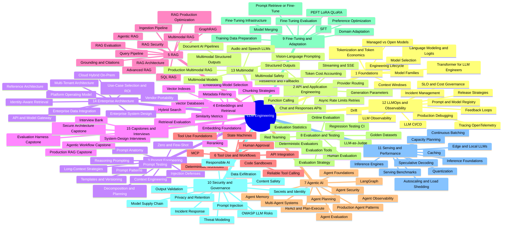
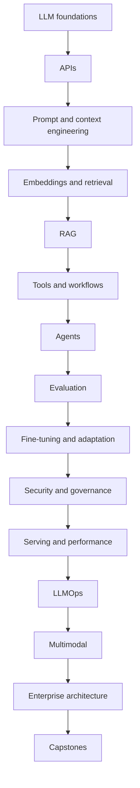
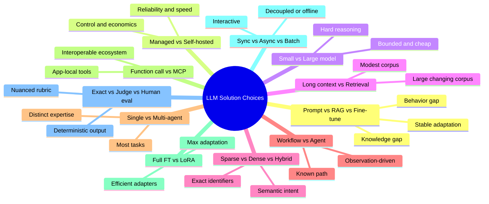
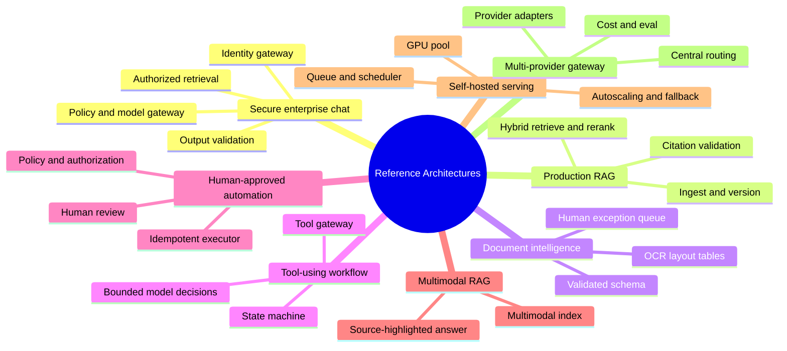
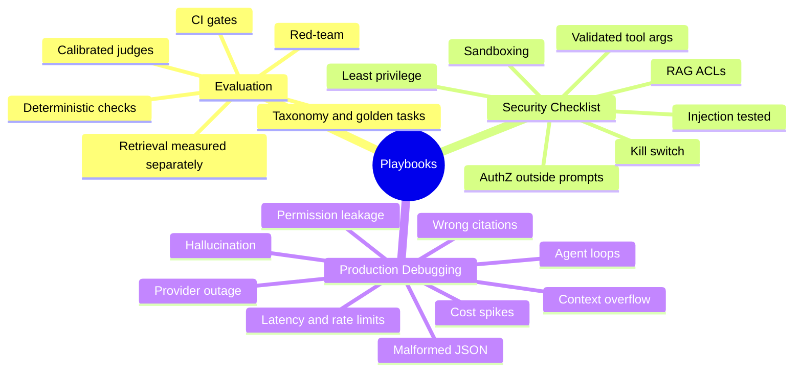

# LLM Engineering — Mindmap

> Visual map of the **140 topics** in the [LLM reference](../llm/llm-index.md), grouped into 15 categories.

## Mindmap

## Category Breakdown

| # | Category | Topics | Level | Est. Time |
|---|---|---|---|---|
| 1 | LLM Engineering Foundations | 01–08 | Foundational | 48–80 h |
| 2 | LLM API and Application Engineering | 09–17 | Foundational | 54–90 h |
| 3 | Prompt Engineering | 18–27 | Foundational | 60–100 h |
| 4 | Embeddings and Semantic Retrieval | 28–37 | Intermediate | 60–100 h |
| 5 | Retrieval-Augmented Generation | 38–49 | Intermediate | 72–120 h |
| 6 | Tool Use and Workflow Automation | 50–57 | Intermediate | 48–80 h |
| 7 | Agentic AI Engineering | 58–67 | Intermediate | 60–100 h |
| 8 | LLM Evaluation and Testing | 68–77 | Advanced | 60–100 h |
| 9 | Fine-Tuning and Model Adaptation | 78–86 | Advanced | 54–90 h |
| 10 | LLM Security, Safety and Governance | 87–97 | Advanced | 66–110 h |
| 11 | LLM Serving and Performance Engineering | 98–107 | Advanced | 60–100 h |
| 12 | LLMOps and Observability | 108–117 | Advanced | 60–100 h |
| 13 | Multimodal LLM Engineering | 118–124 | Advanced | 42–70 h |
| 14 | Enterprise LLM Architecture | 125–134 | Architecture | 60–100 h |
| 15 | Capstones and Interview Preparation | 135–140 | Architecture | 36–60 h |

> Each topic lives at `../llm/NNN-<slug>.md`; the full per-topic list with links is in the [LLM index](../llm/llm-index.md#repository-file-map).

## Learning Path

## Solution Selection Map

## Reference Architectures

## Playbooks

