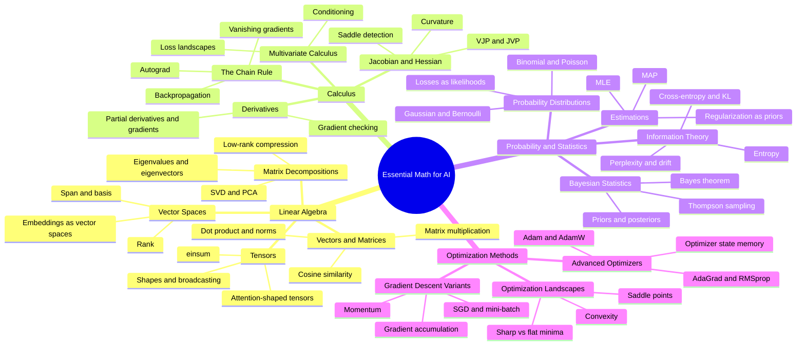
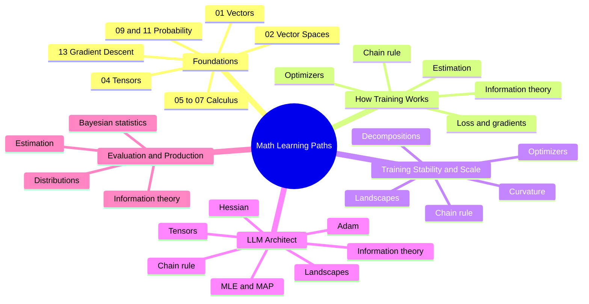
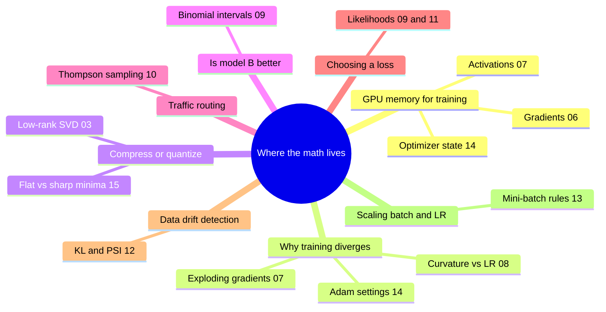

# Essential Math for AI — Mindmap

> Visual map of the **15 math topics** in the [Math reference](../math/math-index.md), grouped into 4 categories.

## Mindmap

## Category Breakdown

| # | Category | Topics | Core Idea |
|---|---|---|---|
| 1 | Linear Algebra | 01–04 | Data, embeddings and weights as vectors, matrices and tensors |
| 2 | Calculus | 05–08 | How loss changes with parameters: gradients, chain rule, curvature |
| 3 | Probability and Statistics | 09–12 | Uncertainty, likelihood-based losses, information measures |
| 4 | Optimization Methods | 13–15 | Turning gradients into stable, efficient parameter updates |

## Topic Links by Category

| Category | Topics |
|---|---|
| Linear Algebra | [01 Vectors and Matrices](../math/01_Vectors%20and%20Matrices.md) · [02 Vector Spaces](../math/02_Vector%20Spaces.md) · [03 Matrix Decompositions](../math/03_Matrix%20Decompositions.md) · [04 Tensors](../math/04_Tensors.md) |
| Calculus | [05 Multivariate Calculus](../math/05_Multivariate%20Calculus.md) · [06 Derivatives](../math/06_Derivatives.md) · [07 The Chain Rule](../math/07_The%20Chain%20Rule.md) · [08 Jacobian and Hessian](../math/08_Jacobian%20and%20Hessian.md) |
| Probability and Statistics | [09 Probability Distributions](../math/09_Probability%20Distributions.md) · [10 Bayesian Statistics](../math/10_Bayesian%20Statistics.md) · [11 Estimations](../math/11_Estimations.md) · [12 Information Theory](../math/12_Information%20Theory.md) |
| Optimization Methods | [13 Gradient Descent Variants](../math/13_Gradient%20Descent%20Variants.md) · [14 Advanced Optimizers](../math/14_Advanced%20Optimizers.md) · [15 Optimization Landscapes](../math/15_Optimization%20Landscapes.md) |

## Learning Paths (from the Math index)

## Architect's Question Map

