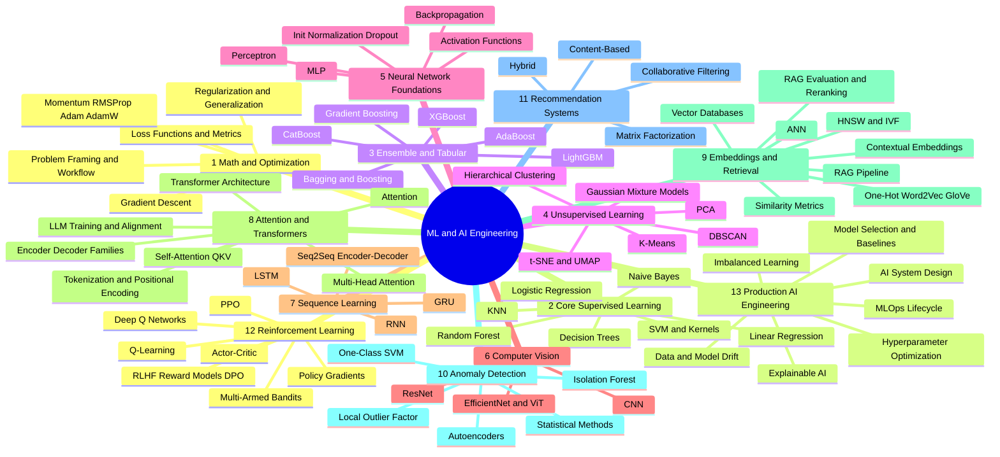
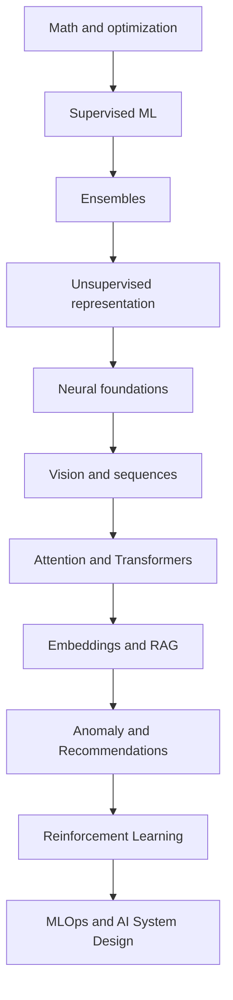
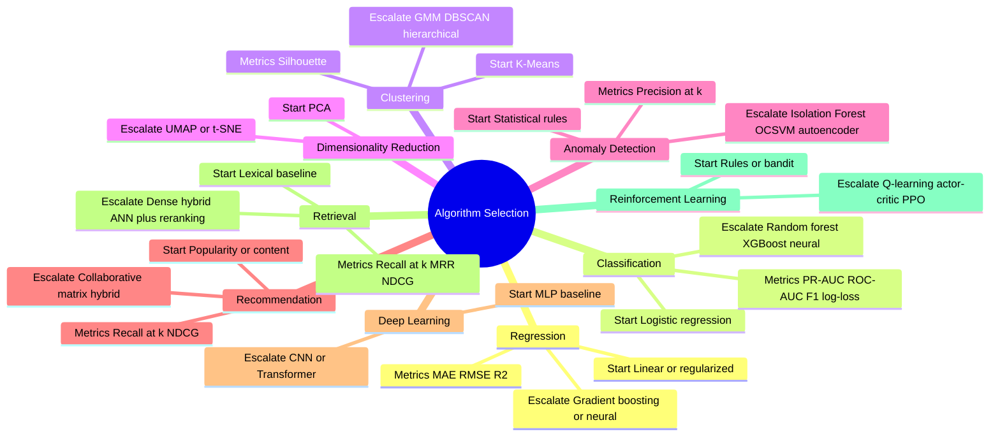
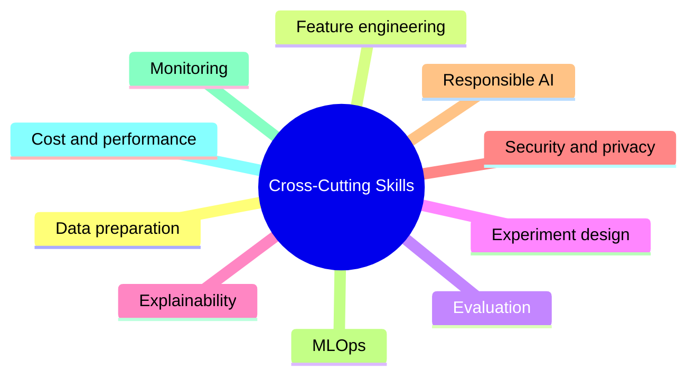

# Machine Learning and AI Engineering — Mindmap

> Visual map of the **74 topics** in the [ML reference](../ml/ml-index.md), grouped into 13 categories.

## Mindmap

## Category Breakdown

| # | Category | Topics | Level | Est. Time |
|---|---|---|---|---|
| 1 | Math and Optimization Foundations | 01–05 | Foundational | 25–40 h |
| 2 | Core Supervised Learning | 06–12 | Foundational | 35–56 h |
| 3 | Ensemble and High-Performance Tabular | 13–18 | Intermediate | 30–48 h |
| 4 | Unsupervised Learning and Representation | 19–24 | Intermediate | 30–48 h |
| 5 | Neural Network Foundations | 25–29 | Intermediate | 25–40 h |
| 6 | Computer Vision Foundations | 30–32 | Intermediate | 15–24 h |
| 7 | Sequence Learning | 33–36 | Intermediate | 20–32 h |
| 8 | Attention, Transformers and LLM Foundations | 37–43 | Advanced | 35–56 h |
| 9 | Embeddings, Similarity and Retrieval | 44–51 | Advanced | 40–64 h |
| 10 | Anomaly Detection | 52–56 | Advanced | 25–40 h |
| 11 | Recommendation Systems | 57–60 | Advanced | 20–32 h |
| 12 | Reinforcement Learning and Preference Optimization | 61–67 | Advanced | 35–56 h |
| 13 | Production Model Selection and AI Engineering | 68–74 | Architecture | 35–56 h |

## Learning Path

## Topic Links by Category

| Category | Topics |
|---|---|
| 1 Math and Optimization | [01 Framing](../ml/01-ml-problem-framing-and-workflow.md) · [02 Loss and Metrics](../ml/02-loss-functions-and-evaluation-metrics.md) · [03 Gradient Descent](../ml/03-gradient-descent-and-optimization.md) · [04 Adam family](../ml/04-momentum-rmsprop-adam-adamw.md) · [05 Regularization](../ml/05-regularization-and-generalization.md) |
| 2 Core Supervised | [06 Linear Regression](../ml/06-linear-regression.md) · [07 Logistic Regression](../ml/07-logistic-regression.md) · [08 KNN](../ml/08-knn.md) · [09 Naive Bayes](../ml/09-naive-bayes.md) · [10 Decision Trees](../ml/10-decision-trees.md) · [11 Random Forest](../ml/11-random-forest.md) · [12 SVM](../ml/12-support-vector-machines.md) |
| 3 Ensemble and Tabular | [13 Bagging and Boosting](../ml/13-ensemble-learning-bagging-and-boosting.md) · [14 AdaBoost](../ml/14-adaboost.md) · [15 Gradient Boosting](../ml/15-gradient-boosting.md) · [16 XGBoost](../ml/16-xgboost.md) · [17 LightGBM](../ml/17-lightgbm.md) · [18 CatBoost](../ml/18-catboost.md) |
| 4 Unsupervised | [19 K-Means](../ml/19-k-means-clustering.md) · [20 Hierarchical](../ml/20-hierarchical-clustering.md) · [21 DBSCAN](../ml/21-dbscan.md) · [22 GMM](../ml/22-gaussian-mixture-models.md) · [23 PCA](../ml/23-pca.md) · [24 t-SNE and UMAP](../ml/24-tsne-and-umap.md) |
| 5 Neural Foundations | [25 Perceptron](../ml/25-perceptron.md) · [26 MLP](../ml/26-multilayer-perceptrons.md) · [27 Activations](../ml/27-activation-functions.md) · [28 Backpropagation](../ml/28-backpropagation.md) · [29 Init, Norm, Dropout](../ml/29-weight-initialization-normalization-and-dropout.md) |
| 6 Computer Vision | [30 CNN](../ml/30-convolutional-neural-networks.md) · [31 ResNet](../ml/31-residual-networks.md) · [32 EfficientNet and ViT](../ml/32-efficientnet-and-vision-transformers.md) |
| 7 Sequence Learning | [33 RNN](../ml/33-recurrent-neural-networks.md) · [34 LSTM](../ml/34-lstm.md) · [35 GRU](../ml/35-gru.md) · [36 Seq2Seq](../ml/36-sequence-to-sequence-and-encoder-decoder.md) |
| 8 Attention and Transformers | [37 Attention](../ml/37-attention-mechanisms.md) · [38 Self-Attention QKV](../ml/38-self-attention-qkv.md) · [39 Multi-Head](../ml/39-multi-head-attention.md) · [40 Transformer](../ml/40-transformer-architecture.md) · [41 Tokenization](../ml/41-tokenization-and-positional-encoding.md) · [42 Model Families](../ml/42-encoder-decoder-and-decoder-only-models.md) · [43 LLM Training](../ml/43-llm-training-fine-tuning-and-alignment.md) |
| 9 Embeddings and Retrieval | [44 Word2Vec and GloVe](../ml/44-one-hot-word2vec-and-glove.md) · [45 Contextual Embeddings](../ml/45-contextual-and-transformer-embeddings.md) · [46 Similarity](../ml/46-similarity-and-distance-metrics.md) · [47 ANN](../ml/47-approximate-nearest-neighbors.md) · [48 HNSW and IVF](../ml/48-hnsw-and-ivf-indexes.md) · [49 Vector DBs](../ml/49-vector-databases.md) · [50 RAG Pipeline](../ml/50-rag-pipeline.md) · [51 RAG Eval](../ml/51-rag-evaluation-and-reranking.md) |
| 10 Anomaly Detection | [52 Statistical](../ml/52-statistical-anomaly-detection.md) · [53 Isolation Forest](../ml/53-isolation-forest.md) · [54 One-Class SVM](../ml/54-one-class-svm.md) · [55 LOF](../ml/55-local-outlier-factor.md) · [56 Autoencoders](../ml/56-autoencoders-for-anomaly-detection.md) |
| 11 Recommenders | [57 Content-Based](../ml/57-content-based-recommendation.md) · [58 Collaborative Filtering](../ml/58-collaborative-filtering.md) · [59 Matrix Factorization](../ml/59-matrix-factorization.md) · [60 Hybrid](../ml/60-hybrid-recommendation-systems.md) |
| 12 Reinforcement Learning | [61 Bandits](../ml/61-multi-armed-bandits.md) · [62 Q-Learning](../ml/62-q-learning.md) · [63 DQN](../ml/63-deep-q-networks.md) · [64 Policy Gradients](../ml/64-policy-gradients.md) · [65 Actor-Critic](../ml/65-actor-critic.md) · [66 PPO](../ml/66-ppo.md) · [67 RLHF and DPO](../ml/67-rlhf-reward-models-and-dpo.md) |
| 13 Production AI Engineering | [68 Model Selection](../ml/68-model-selection-and-baselines.md) · [69 HPO](../ml/69-hyperparameter-optimization.md) · [70 Imbalanced](../ml/70-imbalanced-learning.md) · [71 Explainable AI](../ml/71-explainable-ai.md) · [72 Drift](../ml/72-data-and-model-drift.md) · [73 MLOps](../ml/73-mlops-and-model-lifecycle.md) · [74 AI System Design](../ml/74-ai-system-design.md) |

## Algorithm Selection Map

## Cross-Cutting Skills

