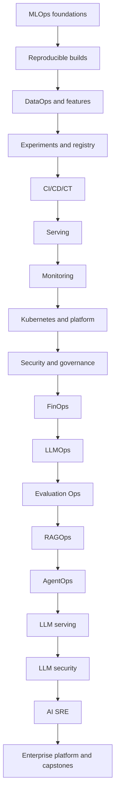
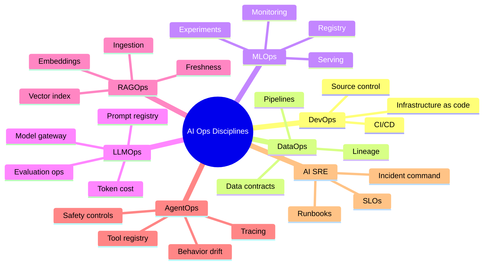
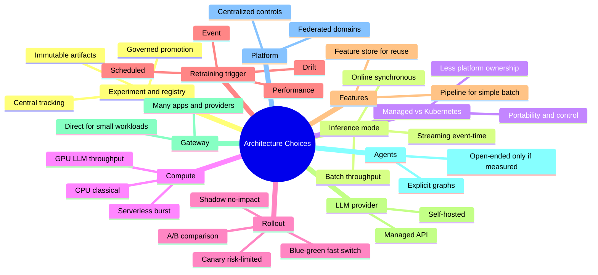
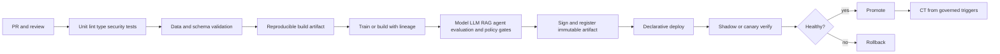
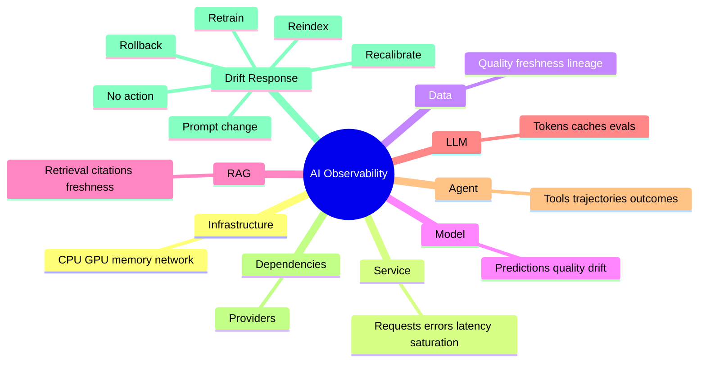
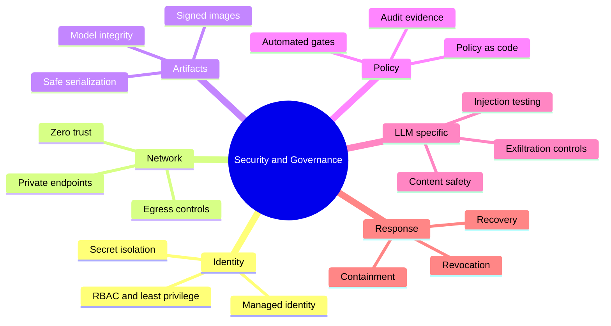

# MLOps and LLMOps — Mindmap

> Visual map of the **200 topics** in the [MLOps/LLMOps reference](../mlops/mlops-llmops-index.md), grouped into 20 categories.

## Mindmap

```mermaid
mindmap
  root((MLOps and LLMOps))
    1 MLOps Foundations
      Overview and Lifecycle
      ML vs Software Lifecycle
      System Components
      Reproducibility
      ML Technical Debt
      Maturity Levels
      DevOps DataOps MLOps LLMOps
      Platform Reference Architecture
      Use-Case Selection
    2 Source Control and Builds
      Git for ML
      Repository Structure
      Python Dependency Management
      Environment Reproducibility
      Docker Foundations
      Container Optimization
      Artifact Versioning
      Data Versioning
      Software Supply Chain
    3 DataOps
      Data Pipelines
      Data Validation
      Data Contracts
      Data Lineage
      Orchestration
      Incremental Processing
      Lakes and Lakehouse
      Streaming ML
      Privacy and Governance
      Pipeline Observability
    4 Feature Engineering and Stores
      Feature Pipelines
      Training-Serving Skew
      Feature Store Foundations
      Offline and Online Stores
      Feature Registry
      Point-in-Time Correctness
      Feature Freshness
      Feast Patterns
      Feature Monitoring
    5 Experiments and Model Dev Ops
      Experiment Tracking
      MLflow Tracking
      Reproducibility
      Hyperparameter Optimization
      Distributed Training Ops
      GPU Experiment Management
      Training Pipelines
      Validation Gates
      Metadata Governance
    6 Model Registry and Artifacts
      Model Registry
      Model Packaging
      Artifact Store
      Model Versioning
      Model Approval
      Environment Promotion
      Model Metadata
      Model Governance
    7 CI/CD/CT for ML
      CI for ML
      ML Testing Pyramid
      CD for Models
      Continuous Training
      Pipeline as Code
      CI Evaluation Gates
      GitHub Actions and Azure DevOps
      GitOps
      Release Management
    8 Deployment and Serving
      Serving Patterns
      FastAPI Serving
      Model Servers
      Inference Containers
      Kubernetes Serving
      Autoscaling
      GPU Inference
      Deployment Strategies
      Model Routing
      Inference Resilience
      Edge ML
    9 Monitoring and Observability
      ML Observability
      Data Drift
      Concept Drift
      Performance Monitoring
      Outlier and Quality
      Fairness Monitoring
      Latency and Throughput
      Prometheus and Grafana
      OpenTelemetry for ML
      Alerting and SLOs
      Retraining Triggers
    10 Kubernetes and Platform
      Kubernetes Foundations
      Resources and Scheduling
      GPU Kubernetes
      Kubeflow
      Infrastructure as Code
      Cloud ML Platforms
      Hybrid On-Prem
      Multi-Tenant Platform
      Self-Service
      Platform APIs
      Platform Reliability
    11 Security Governance Responsible AI
      ML Threat Modeling
      IAM and Secrets
      Network Security
      Encryption
      Model Supply Chain
      Adversarial ML
      Responsible AI Controls
      Regulatory Governance
      Policy as Code
      Security Incident Response
    12 FinOps and Cost
      ML Cost Model
      GPU Cost Engineering
      Inference Cost
      Storage and Transfer Cost
      Cost Allocation
      Cost Optimization
      Cost-Quality Tradeoffs
      FinOps Governance
    13 LLMOps Foundations
      LLMOps Overview
      LLM Artifacts
      Foundation Model Management
      Prompt Registry
      Model Gateway
      Configuration Management
      Output Contracts
      Token Cost Telemetry
      LLM Release Management
    14 LLM Evaluation Operations
      Evaluation Strategy
      Golden Datasets
      Deterministic Evaluators
      LLM-as-Judge
      Human Evaluation
      Evaluation Harness
      Eval Versioning
      Statistical Evaluation
      Eval CI Gates
      Online Experiments
      Red Team Operations
    15 RAGOps
      RAGOps Overview
      Ingestion Pipeline Ops
      Document Versioning
      Embedding Model Ops
      Vector Index Ops
      RAG Metadata Security
      RAG Evaluation Ops
      RAG Observability
      Freshness and Drift
      RAG CI/CD
      RAG Cost and Capacity
      RAG Disaster Recovery
    16 AgentOps
      AgentOps Overview
      Artifact Versioning
      Agent Tracing
      Agent Evaluation Ops
      State and Checkpoints
      Tool Registry
      Safety Controls
      Agent CI/CD
      Behavior Drift
      Agent SLOs
      Agent Incident Response
    17 LLM Serving and Inference Ops
      Inference Architecture
      vLLM TGI Triton
      Quantization Operations
      Continuous Batching
      LLM Autoscaling
      LLM Capacity Planning
      Performance Benchmarking
      LLM Caching
      Serving Resilience
    18 LLM Security and Compliance Ops
      LLM Threat Modeling
      Prompt Injection Ops
      Exfiltration Controls
      Identity and Access
      Content Safety Ops
      Policy as Code
      Auditability
      LLM Supply Chain
      LLM Incident Response
    19 SRE for AI Systems
      AI SRE Foundations
      SLIs and SLOs
      Error and Quality Budgets
      AI Alerting
      Runbooks
      Incident Command
      Chaos for AI
      Capacity and Reliability
      Postmortems
    20 Enterprise Platform Architecture and Capstones
      Enterprise AI Platform
      Control and Data Planes
      Multi-Tenant AI Platform
      Model and Data Gateway
      Enterprise Integration
      Cloud Hybrid Sovereign
      Operating Model
      Build vs Buy
      Platform FinOps
      MLOps Capstone
      LLMOps Capstone
      RAGOps Capstone
      AgentOps Capstone
      AI Platform Capstone
      System-Design Interviews
      Interview Bank
```

## Category Breakdown

| # | Category | Topics |
|---|---|---|
| 1 | MLOps Foundations | 01–09 |
| 2 | Source Control, Environments and Reproducible Builds | 10–18 |
| 3 | Data Engineering and DataOps for ML | 19–28 |
| 4 | Feature Engineering and Feature Stores | 29–37 |
| 5 | Experiment Tracking and Model Development Operations | 38–46 |
| 6 | Model Registry and Artifact Management | 47–54 |
| 7 | CI/CD/CT for ML | 55–63 |
| 8 | Model Deployment and Serving | 64–74 |
| 9 | Model Monitoring and Observability | 75–85 |
| 10 | Kubernetes, Infrastructure and Platform Engineering | 86–96 |
| 11 | MLOps Security, Governance and Responsible AI | 97–106 |
| 12 | FinOps and ML Cost Engineering | 107–114 |
| 13 | LLMOps Foundations | 115–123 |
| 14 | LLM Evaluation Operations | 124–134 |
| 15 | RAGOps | 135–146 |
| 16 | AgentOps | 147–157 |
| 17 | LLM Serving and Inference Operations | 158–166 |
| 18 | LLM Security, Governance and Compliance Operations | 167–175 |
| 19 | SRE for AI Systems | 176–184 |
| 20 | Enterprise AI Platform Architecture and Capstones | 185–200 |

> Each topic lives at `../mlops/NNN-<slug>.md`; the full per-topic list with links is in the [MLOps/LLMOps index](../mlops/mlops-llmops-index.md#repository-file-map).

## Learning Path

## Ops Discipline Hierarchy

## Architecture Selection Map

## CI/CD/CT Playbook

## Observability and Drift

## Security and Governance

