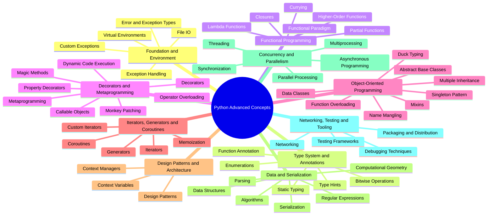
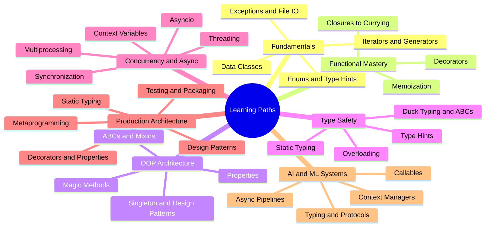
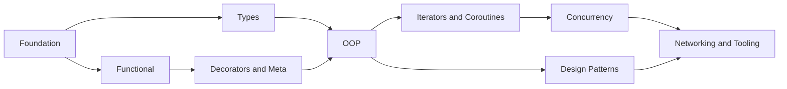

# Python Advanced Concepts — Mindmap

> Visual map of the **55 topics** in the [Python reference](../python/python-index.md), grouped into the 10 categories used in the navigation.

## Mindmap

## Category Breakdown

| # | Category | Topic Numbers | Core Idea |
|---|---|---|---|
| 1 | Foundation and Environment | 01–05 | Isolated environments, robust error handling and file access |
| 2 | Type System and Annotations | 06–10 | Making intent explicit and statically checkable |
| 3 | Functional Programming | 11–16 | Functions as values: closures, composition, purity |
| 4 | Decorators and Metaprogramming | 17–21, 38–40 | Code that wraps, patches and generates code |
| 5 | Object-Oriented Programming | 22–28, 34 | Modelling with classes, protocols and inheritance |
| 6 | Iterators, Generators and Coroutines | 29–33 | Lazy evaluation and resumable functions |
| 7 | Design Patterns and Architecture | 35–37 | Reusable structure and resource/context scoping |
| 8 | Data and Serialization | 41–46 | Parsing, persistence, data structures and algorithms |
| 9 | Concurrency and Parallelism | 47–51 | Threads, processes and async I/O |
| 10 | Networking, Testing and Tooling | 52–55 | Shipping, testing and debugging real systems |

## Topic Links by Category

| Category | Topics |
|---|---|
| Foundation and Environment | [01 Virtual Environments](../python/01_Python%20Virtual%20Environments.md) · [02 Exception Handling](../python/02_Exception%20Handling.md) · [03 Exception Types](../python/03_Error%20and%20Exception%20Types.md) · [04 Custom Exceptions](../python/04_Custom%20Exceptions.md) · [05 File I/O](../python/05_File%20I-O.md) |
| Type System and Annotations | [06 Bitwise Operations](../python/06_Bitwise%20Operations.md) · [07 Enumerations](../python/07_Enumerations.md) · [08 Type Hints](../python/08_Type%20Hints.md) · [09 Function Annotation](../python/09_Function%20Annotation.md) · [10 Static Typing](../python/10_Static%20Typing.md) |
| Functional Programming | [11 Closures](../python/11_Closures.md) · [12 Lambda Functions](../python/12_Lambda%20Functions.md) · [13 Higher-Order Functions](../python/13_Higher-Order%20Functions.md) · [14 Partial Functions](../python/14_Partial%20Functions.md) · [15 Currying](../python/15_Currying.md) · [16 Functional Paradigm](../python/16_Functional%20Programming%20Paradigm.md) |
| Decorators and Metaprogramming | [17 Decorators](../python/17_Decorators.md) · [18 Property Decorators](../python/18_Property%20Decorators.md) · [19 Magic Methods](../python/19_Magic%20Methods.md) · [20 Operator Overloading](../python/20_Operator%20Overloading.md) · [21 Callable Objects](../python/21_Callable%20Objects.md) · [38 Monkey Patching](../python/38_Monkey%20Patching.md) · [39 Metaprogramming](../python/39_Metaprogramming.md) · [40 Dynamic Code Execution](../python/40_Dynamic%20Code%20Execution%20(eval%2C%20exec).md) |
| Object-Oriented Programming | [22 Data Classes](../python/22_Data%20Classes.md) · [23 Duck Typing](../python/23_Duck%20Typing.md) · [24 Multiple Inheritance](../python/24_Multiple%20Inheritance.md) · [25 Mixins](../python/25_Mixins.md) · [26 Abstract Base Classes](../python/26_Abstract%20Base%20Classes%20(ABCs).md) · [27 Name Mangling](../python/27_Name%20Mangling.md) · [28 Function Overloading](../python/28_Function%20Overloading.md) · [34 Singleton Pattern](../python/34_Singleton%20Pattern.md) |
| Iterators, Generators and Coroutines | [29 Iterators](../python/29_Iterators.md) · [30 Custom Iterators](../python/30_Custom%20Iterators.md) · [31 Generators](../python/31_Generators.md) · [32 Coroutines](../python/32_Coroutines.md) · [33 Memoization](../python/33_Memoization.md) |
| Design Patterns and Architecture | [35 Design Patterns](../python/35_Design%20Patterns.md) · [36 Context Managers](../python/36_Context%20Managers.md) · [37 Context Variables](../python/37_Context%20Variables.md) |
| Data and Serialization | [41 Serialization](../python/41_Serialization%20(Pickling%2C%20JSON).md) · [42 Regular Expressions](../python/42_Regular%20Expressions.md) · [43 Parsing](../python/43_Parsing%20(XML%2C%20JSON%2C%20HTML).md) · [44 Data Structures](../python/44_Data%20Structures%20(Linked%20Lists%2C%20Trees%2C%20Graphs).md) · [45 Algorithms](../python/45_Algorithms%20(Sorting%2C%20Searching).md) · [46 Computational Geometry](../python/46_Computational%20Geometry.md) |
| Concurrency and Parallelism | [47 Threading](../python/47_Threading.md) · [48 Synchronization](../python/48_Synchronization%20(Locks%2C%20Semaphores).md) · [49 Multiprocessing](../python/49_Multiprocessing.md) · [50 Parallel Processing](../python/50_Parallel%20Processing.md) · [51 Asynchronous Programming](../python/51_Asynchronous%20Programming.md) |
| Networking, Testing and Tooling | [52 Networking](../python/52_Networking%20(Sockets%2C%20HTTP).md) · [53 Debugging Techniques](../python/53_Debugging%20Techniques.md) · [54 Testing Frameworks](../python/54_Testing%20Frameworks%20(e.g.%2C%20pytest%2C%20unittest).md) · [55 Packaging and Distribution](../python/55_Packaging%20and%20Distribution.md) |

## Learning Paths (from the Python index)

## Key Relationships

