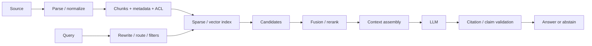

# Namespaces, Collections, Shards, Tenants, and Time-Based Partitioning

## 1. Title and Learning Position
- **Category:** Vector Indexes and Databases
- **Prerequisites:** [Metadata Filtering, Prefiltering, Postfiltering, and Selectivity](46-metadata-filtering.md)
- **Why it matters:** Namespaces, Collections, Shards, Tenants, and Time-Based Partitioning is part of the retrieval-to-evidence chain required to build grounded, secure and measurable RAG systems.
- **Learning objectives:** explain the IR/RAG mechanism; implement a safe baseline; preserve provenance and authorization; design retrieval/generation evaluation; diagnose failure; choose production architecture.
- **Difficulty:** Foundational
- **Estimated study time:** 4-8 hours plus 2-4 hours of experimentation.
- **Practical competency:** implement and review Namespaces, Collections, Shards, Tenants, and Time-Based Partitioning using measurable retrieval, grounding, security and operational criteria.

## 2. Concept
**Beginner.** RAG retrieves external evidence at request time and supplies selected evidence to a generative model. Start by defining the information need, the authoritative source, the retrieval unit and what counts as relevant evidence.

**Intermediate.** Separate indexing-time behavior from query-time behavior. Indexing establishes canonical documents, chunks, metadata, embeddings/terms and ACLs. Query time transforms the question, retrieves authorized candidates, fuses/reranks them, assembles context and validates generated citations.

**Advanced.** Analyze relevance distributions, ANN recall, metadata selectivity, update/delete semantics, freshness, source authority, contradictory evidence, multimodal signals, injection/poisoning, tail latency, cost and regression risk.

**Mathematical/design anchor.** RAG decomposes evidence acquisition from generation. Let retrieved set $D_k(q)$ contain the top-$k$ evidence units for query $q$; answer quality depends on both evidence recall/precision and how faithfully generation uses that evidence.

**Canonical structures:** preserve `source_id`, `document_id`, `document_version`, `chunk_id`, timestamps, structural path, text/content reference, ACL/security principals, parser/chunker/embedding versions and source URI. Query traces additionally preserve transformed query, filters, candidate/reranked scores, context selection and cited evidence IDs.

**Indexing vs query time:** expensive parsing/chunking/embedding normally happens asynchronously; access filtering, routing, retrieval, reranking and context assembly happen per query. Incremental ingestion must support update, delete, retry, replay and idempotency.

**Failure modes:** parser/OCR loss, bad chunk boundaries, wrong embedding version, filter overconstraint, low ANN recall, stale index, duplicate candidates, reranker regression, context conflict, hallucination, bad citation mapping, prompt injection and cross-tenant leakage.



## 3. Intermediate and Advanced Use Cases
### Intermediate search
**Problem:** Apply Namespaces, Collections, Shards, Tenants, and Time-Based Partitioning to an internal policy/engineering corpus. **Source/update:** versioned authoritative sources with explicit freshness targets. **Access control:** propagate tenant/user/group ACLs into retrievable metadata and fail closed. **Architecture:** source -> parse/normalize -> chunk/metadata -> sparse/dense index -> query transform -> authorized candidate retrieval -> fusion/rerank -> context -> generation -> citation validation. **Selection:** compare relevance, filter capability, updates, scale, privacy, latency, cost and operational ownership. **Evaluation:** retrieval metrics plus final correctness/faithfulness/citations and online task success. **Risks:** stale/duplicate content, missed evidence, poisoned content, semantic drift, permission leakage and cost/latency growth. **Fallback:** lexical search, narrower trusted corpus, abstention/clarification or human review. **Alternatives:** long context, SQL/search directly, deterministic APIs or fine-tuning depending on the actual problem.
### Intermediate enterprise
**Problem:** Use Namespaces, Collections, Shards, Tenants, and Time-Based Partitioning over Oracle ERP/procurement, Jira, SharePoint or Confluence-derived knowledge. **Source/update:** versioned authoritative sources with explicit freshness targets. **Access control:** propagate tenant/user/group ACLs into retrievable metadata and fail closed. **Architecture:** source -> parse/normalize -> chunk/metadata -> sparse/dense index -> query transform -> authorized candidate retrieval -> fusion/rerank -> context -> generation -> citation validation. **Selection:** compare relevance, filter capability, updates, scale, privacy, latency, cost and operational ownership. **Evaluation:** retrieval metrics plus final correctness/faithfulness/citations and online task success. **Risks:** stale/duplicate content, missed evidence, poisoned content, semantic drift, permission leakage and cost/latency growth. **Fallback:** lexical search, narrower trusted corpus, abstention/clarification or human review. **Alternatives:** long context, SQL/search directly, deterministic APIs or fine-tuning depending on the actual problem.
### Advanced quality
**Problem:** Optimize Namespaces, Collections, Shards, Tenants, and Time-Based Partitioning using a versioned golden set and ablation tests. **Source/update:** versioned authoritative sources with explicit freshness targets. **Access control:** propagate tenant/user/group ACLs into retrievable metadata and fail closed. **Architecture:** source -> parse/normalize -> chunk/metadata -> sparse/dense index -> query transform -> authorized candidate retrieval -> fusion/rerank -> context -> generation -> citation validation. **Selection:** compare relevance, filter capability, updates, scale, privacy, latency, cost and operational ownership. **Evaluation:** retrieval metrics plus final correctness/faithfulness/citations and online task success. **Risks:** stale/duplicate content, missed evidence, poisoned content, semantic drift, permission leakage and cost/latency growth. **Fallback:** lexical search, narrower trusted corpus, abstention/clarification or human review. **Alternatives:** long context, SQL/search directly, deterministic APIs or fine-tuning depending on the actual problem.
### Advanced scale
**Problem:** Operate Namespaces, Collections, Shards, Tenants, and Time-Based Partitioning with corpus growth, frequent updates, concurrency, ACL filtering and latency constraints. **Source/update:** versioned authoritative sources with explicit freshness targets. **Access control:** propagate tenant/user/group ACLs into retrievable metadata and fail closed. **Architecture:** source -> parse/normalize -> chunk/metadata -> sparse/dense index -> query transform -> authorized candidate retrieval -> fusion/rerank -> context -> generation -> citation validation. **Selection:** compare relevance, filter capability, updates, scale, privacy, latency, cost and operational ownership. **Evaluation:** retrieval metrics plus final correctness/faithfulness/citations and online task success. **Risks:** stale/duplicate content, missed evidence, poisoned content, semantic drift, permission leakage and cost/latency growth. **Fallback:** lexical search, narrower trusted corpus, abstention/clarification or human review. **Alternatives:** long context, SQL/search directly, deterministic APIs or fine-tuning depending on the actual problem.
### Enterprise governed
**Problem:** Deploy Namespaces, Collections, Shards, Tenants, and Time-Based Partitioning with identity-aware retrieval, auditability, monitoring, rollback and disaster recovery. **Source/update:** versioned authoritative sources with explicit freshness targets. **Access control:** propagate tenant/user/group ACLs into retrievable metadata and fail closed. **Architecture:** source -> parse/normalize -> chunk/metadata -> sparse/dense index -> query transform -> authorized candidate retrieval -> fusion/rerank -> context -> generation -> citation validation. **Selection:** compare relevance, filter capability, updates, scale, privacy, latency, cost and operational ownership. **Evaluation:** retrieval metrics plus final correctness/faithfulness/citations and online task success. **Risks:** stale/duplicate content, missed evidence, poisoned content, semantic drift, permission leakage and cost/latency growth. **Fallback:** lexical search, narrower trusted corpus, abstention/clarification or human review. **Alternatives:** long context, SQL/search directly, deterministic APIs or fine-tuning depending on the actual problem.

## 4. Python Implementation
**Implementation discipline.** Use typed document/chunk schemas; stable IDs; versioned parsers/chunkers/embedding models; batched/retried embedding calls; explicit ACL filters; deterministic test fixtures; traceable retrieval scores; token budgets; citation mapping; and incremental update/delete workflows.

```python
from pydantic import BaseModel, Field
class Chunk(BaseModel):
    source_id: str
    document_id: str
    document_version: str
    chunk_id: str
    text: str
    acl_principals: list[str] = Field(default_factory=list)
    metadata: dict[str, str] = Field(default_factory=dict)
```

```python
from sklearn.feature_extraction.text import TfidfVectorizer
from sklearn.metrics.pairwise import cosine_similarity
docs = ["supplier approval policy", "purchase order matching", "invoice exception workflow"]
query = "supplier approval requirements"
v = TfidfVectorizer().fit(docs + [query])
D, q = v.transform(docs), v.transform([query])
ranked = sorted(zip(cosine_similarity(q, D)[0], range(len(docs))), reverse=True)
print(ranked)
# Synthetic baseline: compare production dense/hybrid retrieval against this measurable baseline.
```

**Production path:** source connector -> canonical document -> structural extraction -> chunking -> metadata/ACL enrichment -> sparse+dense indexing -> query understanding -> authorized retrieval -> rank fusion/reranking -> evidence context -> grounded prompt -> typed result -> citation verification -> telemetry.

**Async/retries:** bound connector/model/index retries with exponential backoff; use idempotency keys for ingestion; send persistent failures to a dead-letter queue. Never silently drop a delete or ACL update.

**Testing:** unit-test parsers/chunkers/filter extraction; integration-test indexes with stable fixtures; maintain golden relevance labels and answer/citation expectations; load-test p95/p99 latency and update freshness.

**Common mistake:** evaluating only final answers. **Correction:** keep stage-level telemetry and evaluate ingestion quality, retrieval, reranking, context, grounding and citation mapping separately.

## 5. Architectural Considerations
- **Ingestion:** batch for bulk loads, CDC/events for fresher sources; maintain source-of-truth ownership, lineage, retries, deletes and legal/retention behavior. Kafka/Airflow/Spark are appropriate when their event/orchestration/scale requirements exist.
- **Parsing:** parser/OCR choice changes retrieval quality; retain raw-source pointer and parser version so extraction defects can be reproduced.
- **Indexes:** pgvector suits PostgreSQL-centric architectures; OpenSearch/Elasticsearch fits mature lexical/hybrid search; Qdrant/Milvus/Weaviate/Pinecone offer vector-centric operational models; FAISS is a library rather than a managed persistence/security plane. Select using measured relevance, filters/ACLs, update behavior, scale, DR and team operations.
- **ANN:** HNSW favors high recall and online search with memory cost; IVF/PQ can improve scale/compression with training/probe trade-offs. Measure against exact/labelled relevance.
- **Authorization:** apply identity-aware filtering before evidence reaches the model; preserve ACLs at document/chunk level and include tenant boundaries in testing.
- **Freshness:** version indexes/embeddings and support dual-index migrations; define measurable source-to-search freshness SLOs.
- **Query path:** parallelize independent sparse/dense retrieval where safe; apply back pressure, deadlines and bounded candidate/reranker depth.
- **Context:** reserve tokens for instructions/output, order evidence deliberately, remove redundancy and handle source/version conflicts explicitly.
- **Security:** retrieved text is untrusted; separate it from instructions, validate generated links/output, detect corpus poisoning and monitor unusual retrieval/access patterns.
- **Evaluation/CI:** gate releases using golden queries, Recall@k/MRR/NDCG, answer faithfulness/correctness, citation metrics, latency and security regressions. Ragas/DeepEval/TruLens/Phoenix can support evaluation pipelines when calibrated to your rubric.
- **Observability:** OpenTelemetry-style spans should expose ingest, retrieval, filter, rerank, context and generation stages without logging sensitive content unnecessarily.
- **Release/recovery:** shadow/canary parser, embedding, index or prompt changes; retain prior known-good index/release, backups or deterministic rebuild-from-source procedure.
- **Cost:** optimize successful grounded answers per unit cost, considering storage/index memory, embedding/re-embedding, retrieval, reranking, LLM tokens and operational ownership.

## 6. Interview Questions
### Q1. Beginner: What is a critical design decision for **Namespaces, Collections, Shards, Tenants, and Time-Based Partitioning**, and how would you validate it?
**Model answer:** Define the information need and ground truth, choose the simplest retrieval/generation pattern, preserve provenance/ACLs, benchmark retrieval independently from answer generation, inspect failure slices, then measure quality, freshness, latency and cost under production constraints.

**Evaluates:** IR/RAG understanding, experimental discipline, security awareness and system-design judgment.

**Weak answer:** naming a vector database, embedding model or framework without ground truth, metrics, authorization or failure analysis.

**Follow-up:** How would your design change for stale data, restrictive ACLs, poor ANN recall, multimodal evidence or a provider outage?

### Q2. Beginner: What is a critical design decision for **Namespaces, Collections, Shards, Tenants, and Time-Based Partitioning**, and how would you validate it?
**Model answer:** Define the information need and ground truth, choose the simplest retrieval/generation pattern, preserve provenance/ACLs, benchmark retrieval independently from answer generation, inspect failure slices, then measure quality, freshness, latency and cost under production constraints.

**Evaluates:** IR/RAG understanding, experimental discipline, security awareness and system-design judgment.

**Weak answer:** naming a vector database, embedding model or framework without ground truth, metrics, authorization or failure analysis.

**Follow-up:** How would your design change for stale data, restrictive ACLs, poor ANN recall, multimodal evidence or a provider outage?

### Q3. Beginner: What is a critical design decision for **Namespaces, Collections, Shards, Tenants, and Time-Based Partitioning**, and how would you validate it?
**Model answer:** Define the information need and ground truth, choose the simplest retrieval/generation pattern, preserve provenance/ACLs, benchmark retrieval independently from answer generation, inspect failure slices, then measure quality, freshness, latency and cost under production constraints.

**Evaluates:** IR/RAG understanding, experimental discipline, security awareness and system-design judgment.

**Weak answer:** naming a vector database, embedding model or framework without ground truth, metrics, authorization or failure analysis.

**Follow-up:** How would your design change for stale data, restrictive ACLs, poor ANN recall, multimodal evidence or a provider outage?

### Q4. Beginner: What is a critical design decision for **Namespaces, Collections, Shards, Tenants, and Time-Based Partitioning**, and how would you validate it?
**Model answer:** Define the information need and ground truth, choose the simplest retrieval/generation pattern, preserve provenance/ACLs, benchmark retrieval independently from answer generation, inspect failure slices, then measure quality, freshness, latency and cost under production constraints.

**Evaluates:** IR/RAG understanding, experimental discipline, security awareness and system-design judgment.

**Weak answer:** naming a vector database, embedding model or framework without ground truth, metrics, authorization or failure analysis.

**Follow-up:** How would your design change for stale data, restrictive ACLs, poor ANN recall, multimodal evidence or a provider outage?

### Q5. Beginner: What is a critical design decision for **Namespaces, Collections, Shards, Tenants, and Time-Based Partitioning**, and how would you validate it?
**Model answer:** Define the information need and ground truth, choose the simplest retrieval/generation pattern, preserve provenance/ACLs, benchmark retrieval independently from answer generation, inspect failure slices, then measure quality, freshness, latency and cost under production constraints.

**Evaluates:** IR/RAG understanding, experimental discipline, security awareness and system-design judgment.

**Weak answer:** naming a vector database, embedding model or framework without ground truth, metrics, authorization or failure analysis.

**Follow-up:** How would your design change for stale data, restrictive ACLs, poor ANN recall, multimodal evidence or a provider outage?

### Q6. Intermediate: What is a critical design decision for **Namespaces, Collections, Shards, Tenants, and Time-Based Partitioning**, and how would you validate it?
**Model answer:** Define the information need and ground truth, choose the simplest retrieval/generation pattern, preserve provenance/ACLs, benchmark retrieval independently from answer generation, inspect failure slices, then measure quality, freshness, latency and cost under production constraints.

**Evaluates:** IR/RAG understanding, experimental discipline, security awareness and system-design judgment.

**Weak answer:** naming a vector database, embedding model or framework without ground truth, metrics, authorization or failure analysis.

**Follow-up:** How would your design change for stale data, restrictive ACLs, poor ANN recall, multimodal evidence or a provider outage?

### Q7. Intermediate: What is a critical design decision for **Namespaces, Collections, Shards, Tenants, and Time-Based Partitioning**, and how would you validate it?
**Model answer:** Define the information need and ground truth, choose the simplest retrieval/generation pattern, preserve provenance/ACLs, benchmark retrieval independently from answer generation, inspect failure slices, then measure quality, freshness, latency and cost under production constraints.

**Evaluates:** IR/RAG understanding, experimental discipline, security awareness and system-design judgment.

**Weak answer:** naming a vector database, embedding model or framework without ground truth, metrics, authorization or failure analysis.

**Follow-up:** How would your design change for stale data, restrictive ACLs, poor ANN recall, multimodal evidence or a provider outage?

### Q8. Intermediate: What is a critical design decision for **Namespaces, Collections, Shards, Tenants, and Time-Based Partitioning**, and how would you validate it?
**Model answer:** Define the information need and ground truth, choose the simplest retrieval/generation pattern, preserve provenance/ACLs, benchmark retrieval independently from answer generation, inspect failure slices, then measure quality, freshness, latency and cost under production constraints.

**Evaluates:** IR/RAG understanding, experimental discipline, security awareness and system-design judgment.

**Weak answer:** naming a vector database, embedding model or framework without ground truth, metrics, authorization or failure analysis.

**Follow-up:** How would your design change for stale data, restrictive ACLs, poor ANN recall, multimodal evidence or a provider outage?

### Q9. Intermediate: What is a critical design decision for **Namespaces, Collections, Shards, Tenants, and Time-Based Partitioning**, and how would you validate it?
**Model answer:** Define the information need and ground truth, choose the simplest retrieval/generation pattern, preserve provenance/ACLs, benchmark retrieval independently from answer generation, inspect failure slices, then measure quality, freshness, latency and cost under production constraints.

**Evaluates:** IR/RAG understanding, experimental discipline, security awareness and system-design judgment.

**Weak answer:** naming a vector database, embedding model or framework without ground truth, metrics, authorization or failure analysis.

**Follow-up:** How would your design change for stale data, restrictive ACLs, poor ANN recall, multimodal evidence or a provider outage?

### Q10. Intermediate: What is a critical design decision for **Namespaces, Collections, Shards, Tenants, and Time-Based Partitioning**, and how would you validate it?
**Model answer:** Define the information need and ground truth, choose the simplest retrieval/generation pattern, preserve provenance/ACLs, benchmark retrieval independently from answer generation, inspect failure slices, then measure quality, freshness, latency and cost under production constraints.

**Evaluates:** IR/RAG understanding, experimental discipline, security awareness and system-design judgment.

**Weak answer:** naming a vector database, embedding model or framework without ground truth, metrics, authorization or failure analysis.

**Follow-up:** How would your design change for stale data, restrictive ACLs, poor ANN recall, multimodal evidence or a provider outage?

### Q11. Advanced: What is a critical design decision for **Namespaces, Collections, Shards, Tenants, and Time-Based Partitioning**, and how would you validate it?
**Model answer:** Define the information need and ground truth, choose the simplest retrieval/generation pattern, preserve provenance/ACLs, benchmark retrieval independently from answer generation, inspect failure slices, then measure quality, freshness, latency and cost under production constraints.

**Evaluates:** IR/RAG understanding, experimental discipline, security awareness and system-design judgment.

**Weak answer:** naming a vector database, embedding model or framework without ground truth, metrics, authorization or failure analysis.

**Follow-up:** How would your design change for stale data, restrictive ACLs, poor ANN recall, multimodal evidence or a provider outage?

### Q12. Advanced: What is a critical design decision for **Namespaces, Collections, Shards, Tenants, and Time-Based Partitioning**, and how would you validate it?
**Model answer:** Define the information need and ground truth, choose the simplest retrieval/generation pattern, preserve provenance/ACLs, benchmark retrieval independently from answer generation, inspect failure slices, then measure quality, freshness, latency and cost under production constraints.

**Evaluates:** IR/RAG understanding, experimental discipline, security awareness and system-design judgment.

**Weak answer:** naming a vector database, embedding model or framework without ground truth, metrics, authorization or failure analysis.

**Follow-up:** How would your design change for stale data, restrictive ACLs, poor ANN recall, multimodal evidence or a provider outage?

### Q13. Advanced: What is a critical design decision for **Namespaces, Collections, Shards, Tenants, and Time-Based Partitioning**, and how would you validate it?
**Model answer:** Define the information need and ground truth, choose the simplest retrieval/generation pattern, preserve provenance/ACLs, benchmark retrieval independently from answer generation, inspect failure slices, then measure quality, freshness, latency and cost under production constraints.

**Evaluates:** IR/RAG understanding, experimental discipline, security awareness and system-design judgment.

**Weak answer:** naming a vector database, embedding model or framework without ground truth, metrics, authorization or failure analysis.

**Follow-up:** How would your design change for stale data, restrictive ACLs, poor ANN recall, multimodal evidence or a provider outage?

### Q14. Advanced: What is a critical design decision for **Namespaces, Collections, Shards, Tenants, and Time-Based Partitioning**, and how would you validate it?
**Model answer:** Define the information need and ground truth, choose the simplest retrieval/generation pattern, preserve provenance/ACLs, benchmark retrieval independently from answer generation, inspect failure slices, then measure quality, freshness, latency and cost under production constraints.

**Evaluates:** IR/RAG understanding, experimental discipline, security awareness and system-design judgment.

**Weak answer:** naming a vector database, embedding model or framework without ground truth, metrics, authorization or failure analysis.

**Follow-up:** How would your design change for stale data, restrictive ACLs, poor ANN recall, multimodal evidence or a provider outage?

### Q15. Advanced: What is a critical design decision for **Namespaces, Collections, Shards, Tenants, and Time-Based Partitioning**, and how would you validate it?
**Model answer:** Define the information need and ground truth, choose the simplest retrieval/generation pattern, preserve provenance/ACLs, benchmark retrieval independently from answer generation, inspect failure slices, then measure quality, freshness, latency and cost under production constraints.

**Evaluates:** IR/RAG understanding, experimental discipline, security awareness and system-design judgment.

**Weak answer:** naming a vector database, embedding model or framework without ground truth, metrics, authorization or failure analysis.

**Follow-up:** How would your design change for stale data, restrictive ACLs, poor ANN recall, multimodal evidence or a provider outage?

### Q16. Architecture: What is a critical design decision for **Namespaces, Collections, Shards, Tenants, and Time-Based Partitioning**, and how would you validate it?
**Model answer:** Define the information need and ground truth, choose the simplest retrieval/generation pattern, preserve provenance/ACLs, benchmark retrieval independently from answer generation, inspect failure slices, then measure quality, freshness, latency and cost under production constraints.

**Evaluates:** IR/RAG understanding, experimental discipline, security awareness and system-design judgment.

**Weak answer:** naming a vector database, embedding model or framework without ground truth, metrics, authorization or failure analysis.

**Follow-up:** How would your design change for stale data, restrictive ACLs, poor ANN recall, multimodal evidence or a provider outage?

### Q17. Architecture: What is a critical design decision for **Namespaces, Collections, Shards, Tenants, and Time-Based Partitioning**, and how would you validate it?
**Model answer:** Define the information need and ground truth, choose the simplest retrieval/generation pattern, preserve provenance/ACLs, benchmark retrieval independently from answer generation, inspect failure slices, then measure quality, freshness, latency and cost under production constraints.

**Evaluates:** IR/RAG understanding, experimental discipline, security awareness and system-design judgment.

**Weak answer:** naming a vector database, embedding model or framework without ground truth, metrics, authorization or failure analysis.

**Follow-up:** How would your design change for stale data, restrictive ACLs, poor ANN recall, multimodal evidence or a provider outage?

### Q18. Architecture: What is a critical design decision for **Namespaces, Collections, Shards, Tenants, and Time-Based Partitioning**, and how would you validate it?
**Model answer:** Define the information need and ground truth, choose the simplest retrieval/generation pattern, preserve provenance/ACLs, benchmark retrieval independently from answer generation, inspect failure slices, then measure quality, freshness, latency and cost under production constraints.

**Evaluates:** IR/RAG understanding, experimental discipline, security awareness and system-design judgment.

**Weak answer:** naming a vector database, embedding model or framework without ground truth, metrics, authorization or failure analysis.

**Follow-up:** How would your design change for stale data, restrictive ACLs, poor ANN recall, multimodal evidence or a provider outage?

### Q19. Debugging: What is a critical design decision for **Namespaces, Collections, Shards, Tenants, and Time-Based Partitioning**, and how would you validate it?
**Model answer:** Define the information need and ground truth, choose the simplest retrieval/generation pattern, preserve provenance/ACLs, benchmark retrieval independently from answer generation, inspect failure slices, then measure quality, freshness, latency and cost under production constraints.

**Evaluates:** IR/RAG understanding, experimental discipline, security awareness and system-design judgment.

**Weak answer:** naming a vector database, embedding model or framework without ground truth, metrics, authorization or failure analysis.

**Follow-up:** How would your design change for stale data, restrictive ACLs, poor ANN recall, multimodal evidence or a provider outage?

### Q20. Debugging: What is a critical design decision for **Namespaces, Collections, Shards, Tenants, and Time-Based Partitioning**, and how would you validate it?
**Model answer:** Define the information need and ground truth, choose the simplest retrieval/generation pattern, preserve provenance/ACLs, benchmark retrieval independently from answer generation, inspect failure slices, then measure quality, freshness, latency and cost under production constraints.

**Evaluates:** IR/RAG understanding, experimental discipline, security awareness and system-design judgment.

**Weak answer:** naming a vector database, embedding model or framework without ground truth, metrics, authorization or failure analysis.

**Follow-up:** How would your design change for stale data, restrictive ACLs, poor ANN recall, multimodal evidence or a provider outage?

### Q21. Coding: What is a critical design decision for **Namespaces, Collections, Shards, Tenants, and Time-Based Partitioning**, and how would you validate it?
**Model answer:** Define the information need and ground truth, choose the simplest retrieval/generation pattern, preserve provenance/ACLs, benchmark retrieval independently from answer generation, inspect failure slices, then measure quality, freshness, latency and cost under production constraints.

**Evaluates:** IR/RAG understanding, experimental discipline, security awareness and system-design judgment.

**Weak answer:** naming a vector database, embedding model or framework without ground truth, metrics, authorization or failure analysis.

**Follow-up:** How would your design change for stale data, restrictive ACLs, poor ANN recall, multimodal evidence or a provider outage?

### Q22. Coding: What is a critical design decision for **Namespaces, Collections, Shards, Tenants, and Time-Based Partitioning**, and how would you validate it?
**Model answer:** Define the information need and ground truth, choose the simplest retrieval/generation pattern, preserve provenance/ACLs, benchmark retrieval independently from answer generation, inspect failure slices, then measure quality, freshness, latency and cost under production constraints.

**Evaluates:** IR/RAG understanding, experimental discipline, security awareness and system-design judgment.

**Weak answer:** naming a vector database, embedding model or framework without ground truth, metrics, authorization or failure analysis.

**Follow-up:** How would your design change for stale data, restrictive ACLs, poor ANN recall, multimodal evidence or a provider outage?

## 7. Practical Exercises
### Foundational
Build a small corpus with stable IDs and relevance labels, implement a baseline for Namespaces, Collections, Shards, Tenants, and Time-Based Partitioning, and inspect retrieved evidence. **Expected:** reproducible script/notebook. **Evaluate:** correct metadata/provenance and relevance reasoning. **Failures:** lost IDs, leakage, poor parsing or unclear ground truth.

### Intermediate
Compare at least two techniques or parameter settings with Recall@k/MRR/NDCG and final answer/citation evaluation. **Expected:** ablation report. **Evaluate:** stage-level evidence and trade-offs. **Stretch:** add hybrid retrieval or reranking.

### Advanced production
Design an enterprise implementation with incremental ingestion, ACL propagation, embedding/index versioning, SLOs, tracing, quality gates, security, rollback and DR. **Expected:** architecture and runbook. **Evaluate:** quality, freshness, isolation, reliability and cost. **Stretch:** inject stale data, index/provider failure and adversarial content.

## 8. Summary and Revision Checklist
### Key takeaways
- RAG quality begins with authoritative, parseable and properly authorized source data.
- Candidate retrieval and answer generation are different systems and need different metrics.
- Preserve provenance/version/ACL metadata end to end.
- Advanced RAG is justified only by measured failure modes and validated improvement.

### Important formulas and retrieval metrics
Know TF-IDF/BM25 intuition, cosine/dot-product behavior, Recall@k, Precision@k, Hit Rate, MRR, MAP, NDCG and fusion/reranking concepts; understand which stage each metric diagnoses.

### Critical parameters
Chunk size/overlap, embedding model/dimension, ANN search settings, metadata filters, candidate top-k, fusion weights, reranking depth, context budget and generation constraints.

### Architecture/selection checklist
- [ ] Authoritative sources and freshness defined
- [ ] Stable IDs/version/delete semantics defined
- [ ] ACL propagation tested
- [ ] Golden relevance dataset exists
- [ ] Retrieval and generation evaluated separately
- [ ] Latency/cost/capacity measured
- [ ] Rollback/rebuild/DR tested

### Security checklist
- [ ] Retrieved content treated as untrusted
- [ ] ACL/tenant filtering occurs before model context
- [ ] Injection/poisoning/exfiltration tested
- [ ] PII/secrets retention governed
- [ ] Output/citations/links validated

### Common pitfalls
Choosing a vector database before defining relevance; embedding everything without metadata; ignoring deletes; overlarge chunks; tuning only final answer prompts; no golden set; assuming ANN is exact; logging sensitive context; stale ACLs; advanced-RAG complexity without ablation evidence.

### Five flashcards
1. **Q:** What is the first RAG quality question? **A:** Did we retrieve the right authorized evidence?
2. **Q:** Why preserve chunk IDs? **A:** Reproducible citations, updates, deletes, tracing and evaluation.
3. **Q:** Hybrid retrieval? **A:** Combine lexical and semantic strengths, then validate fusion/ranking.
4. **Q:** When use advanced RAG? **A:** When a measured baseline failure is specifically addressed and improvement is demonstrated.
5. **Q:** What should a production RAG release version? **A:** Source/parser/chunker/embedding/index/retrieval/reranker/prompt/evaluation artifacts.

### Next recommended topics
- [Upserts, Tombstones, Deletes, Compaction, and Freshness](48-index-updates-deletes.md)
- [Network, Identity, Encryption, Tenant Isolation, and Audit](49-vector-database-security.md)
