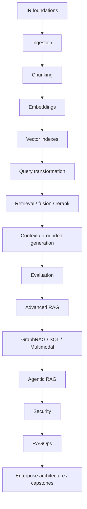
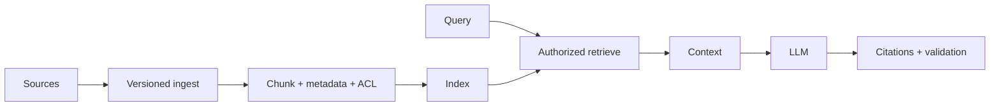

# RAG and Advanced RAG Foundations Notes

## Repository Purpose

A production-oriented path for experienced Python/ML/LLM engineers who want strong information-retrieval, RAG, advanced RAG, security and enterprise architecture skills. Study sequentially, maintain golden relevance datasets, and treat retrieval, generation and authorization as separate measurable concerns.

## Recommended Learning Path

## Category Summary

### Category 1: RAG and Information Retrieval Foundations

**Purpose:** build competency in rag and information retrieval foundations. **Prerequisites:** prior categories unless already proficient. **Estimated study time:** 54-90 hours. **Outcome:** implementation, evaluation, security and architectural fluency.

1. **[RAG Problem Framing, Use-Case Selection, and End-to-End Lifecycle](01-rag-problem-framing.md)**  
   Foundational. Prerequisite: Python, databases, APIs and basic LLM concepts. Study: 4-8 hours. Skill: implement/evaluate/review RAG Problem Framing, Use-Case Selection, and End-to-End Lifecycle.
2. **[RAG vs Long Context, Prompting, Fine-Tuning, Search, and Databases](02-rag-vs-alternatives.md)**  
   Foundational. Prerequisite: RAG Problem Framing, Use-Case Selection, and End-to-End Lifecycle. Study: 4-8 hours. Skill: implement/evaluate/review RAG vs Long Context, Prompting, Fine-Tuning, Search, and Databases.
3. **[Documents, Terms, Inverted Indexes, Relevance, and Ranking](03-information-retrieval-basics.md)**  
   Foundational. Prerequisite: RAG vs Long Context, Prompting, Fine-Tuning, Search, and Databases. Study: 4-8 hours. Skill: implement/evaluate/review Documents, Terms, Inverted Indexes, Relevance, and Ranking.
4. **[TF-IDF, BM25, Sparse Retrieval, and Lexical Matching](04-tf-idf-bm25.md)**  
   Foundational. Prerequisite: Documents, Terms, Inverted Indexes, Relevance, and Ranking. Study: 4-8 hours. Skill: implement/evaluate/review TF-IDF, BM25, Sparse Retrieval, and Lexical Matching.
5. **[Dense Retrieval and Semantic Search](05-dense-retrieval.md)**  
   Foundational. Prerequisite: TF-IDF, BM25, Sparse Retrieval, and Lexical Matching. Study: 4-8 hours. Skill: implement/evaluate/review Dense Retrieval and Semantic Search.
6. **[Embedding Models, Vector Spaces, Dimensions, and Normalization](06-embeddings.md)**  
   Foundational. Prerequisite: Dense Retrieval and Semantic Search. Study: 4-8 hours. Skill: implement/evaluate/review Embedding Models, Vector Spaces, Dimensions, and Normalization.
7. **[Cosine Similarity, Dot Product, Euclidean Distance, and Score Interpretation](07-similarity-metrics.md)**  
   Foundational. Prerequisite: Embedding Models, Vector Spaces, Dimensions, and Normalization. Study: 4-8 hours. Skill: implement/evaluate/review Cosine Similarity, Dot Product, Euclidean Distance, and Score Interpretation.
8. **[Bi-Encoders, Cross-Encoders, Late Interaction, and Retrieval Trade-offs](08-bi-encoders-cross-encoders.md)**  
   Foundational. Prerequisite: Cosine Similarity, Dot Product, Euclidean Distance, and Score Interpretation. Study: 4-8 hours. Skill: implement/evaluate/review Bi-Encoders, Cross-Encoders, Late Interaction, and Retrieval Trade-offs.
9. **[Baseline RAG Reference Architecture](09-rag-reference-architecture.md)**  
   Foundational. Prerequisite: Bi-Encoders, Cross-Encoders, Late Interaction, and Retrieval Trade-offs. Study: 4-8 hours. Skill: implement/evaluate/review Baseline RAG Reference Architecture.

### Category 2: Source Ingestion and Document Processing

**Purpose:** build competency in source ingestion and document processing. **Prerequisites:** prior categories unless already proficient. **Estimated study time:** 66-110 hours. **Outcome:** implementation, evaluation, security and architectural fluency.

10. **[File, Web, SharePoint, Confluence, Database, API, and Event Connectors](10-source-connectors.md)**  
   Foundational. Prerequisite: Baseline RAG Reference Architecture. Study: 4-8 hours. Skill: implement/evaluate/review File, Web, SharePoint, Confluence, Database, API, and Event Connectors.
11. **[Canonical Document, Section, Chunk, Metadata, and Provenance Schemas](11-document-model.md)**  
   Foundational. Prerequisite: File, Web, SharePoint, Confluence, Database, API, and Event Connectors. Study: 4-8 hours. Skill: implement/evaluate/review Canonical Document, Section, Chunk, Metadata, and Provenance Schemas.
12. **[Parsing, Cleaning, Encoding, Boilerplate Removal, and Normalization](12-parsing-normalization.md)**  
   Foundational. Prerequisite: Canonical Document, Section, Chunk, Metadata, and Provenance Schemas. Study: 4-8 hours. Skill: implement/evaluate/review Parsing, Cleaning, Encoding, Boilerplate Removal, and Normalization.
13. **[PDFs, Native Text, Scanned Documents, Layout, and Reading Order](13-pdf-processing.md)**  
   Foundational. Prerequisite: Parsing, Cleaning, Encoding, Boilerplate Removal, and Normalization. Study: 4-8 hours. Skill: implement/evaluate/review PDFs, Native Text, Scanned Documents, Layout, and Reading Order.
14. **[OCR Pipelines, Confidence, Language, Rotation, and Post-Processing](14-ocr.md)**  
   Foundational. Prerequisite: PDFs, Native Text, Scanned Documents, Layout, and Reading Order. Study: 4-8 hours. Skill: implement/evaluate/review OCR Pipelines, Confidence, Language, Rotation, and Post-Processing.
15. **[Tables, Charts, Figures, Captions, and Structured Extraction](15-table-chart-extraction.md)**  
   Foundational. Prerequisite: OCR Pipelines, Confidence, Language, Rotation, and Post-Processing. Study: 4-8 hours. Skill: implement/evaluate/review Tables, Charts, Figures, Captions, and Structured Extraction.
16. **[Stable IDs, Versioning, Change Detection, Deduplication, and Deletion](16-document-versioning.md)**  
   Foundational. Prerequisite: Tables, Charts, Figures, Captions, and Structured Extraction. Study: 4-8 hours. Skill: implement/evaluate/review Stable IDs, Versioning, Change Detection, Deduplication, and Deletion.
17. **[Metadata Extraction, Taxonomy, Entity Extraction, and Classification](17-metadata-enrichment.md)**  
   Foundational. Prerequisite: Stable IDs, Versioning, Change Detection, Deduplication, and Deletion. Study: 4-8 hours. Skill: implement/evaluate/review Metadata Extraction, Taxonomy, Entity Extraction, and Classification.
18. **[Authorization Metadata, ACL Propagation, Tenant and User Scoping](18-access-control-metadata.md)**  
   Foundational. Prerequisite: Metadata Extraction, Taxonomy, Entity Extraction, and Classification. Study: 4-8 hours. Skill: implement/evaluate/review Authorization Metadata, ACL Propagation, Tenant and User Scoping.
19. **[Incremental Loads, CDC, Events, Reprocessing, and Idempotency](19-incremental-ingestion.md)**  
   Foundational. Prerequisite: Authorization Metadata, ACL Propagation, Tenant and User Scoping. Study: 4-8 hours. Skill: implement/evaluate/review Incremental Loads, CDC, Events, Reprocessing, and Idempotency.
20. **[Ingestion Validation, Dead-Letter Queues, Auditability, and Quality Metrics](20-ingestion-quality.md)**  
   Foundational. Prerequisite: Incremental Loads, CDC, Events, Reprocessing, and Idempotency. Study: 4-8 hours. Skill: implement/evaluate/review Ingestion Validation, Dead-Letter Queues, Auditability, and Quality Metrics.

### Category 3: Chunking and Context Units

**Purpose:** build competency in chunking and context units. **Prerequisites:** prior categories unless already proficient. **Estimated study time:** 60-100 hours. **Outcome:** implementation, evaluation, security and architectural fluency.

21. **[Chunking Objectives, Boundaries, Context, and Retrieval Units](21-chunking-foundations.md)**  
   Foundational. Prerequisite: Ingestion Validation, Dead-Letter Queues, Auditability, and Quality Metrics. Study: 4-8 hours. Skill: implement/evaluate/review Chunking Objectives, Boundaries, Context, and Retrieval Units.
22. **[Fixed-Size and Recursive Character/Token Chunking](22-fixed-recursive-chunking.md)**  
   Foundational. Prerequisite: Chunking Objectives, Boundaries, Context, and Retrieval Units. Study: 4-8 hours. Skill: implement/evaluate/review Fixed-Size and Recursive Character/Token Chunking.
23. **[Heading, Section, Markdown, HTML, and Document-Aware Chunking](23-structure-aware-chunking.md)**  
   Foundational. Prerequisite: Fixed-Size and Recursive Character/Token Chunking. Study: 4-8 hours. Skill: implement/evaluate/review Heading, Section, Markdown, HTML, and Document-Aware Chunking.
24. **[Semantic and Embedding-Based Chunking](24-semantic-chunking.md)**  
   Foundational. Prerequisite: Heading, Section, Markdown, HTML, and Document-Aware Chunking. Study: 4-8 hours. Skill: implement/evaluate/review Semantic and Embedding-Based Chunking.
25. **[Sentence, Paragraph, and Sliding-Window Chunking](25-sentence-paragraph-chunking.md)**  
   Foundational. Prerequisite: Semantic and Embedding-Based Chunking. Study: 4-8 hours. Skill: implement/evaluate/review Sentence, Paragraph, and Sliding-Window Chunking.
26. **[Parent-Child and Small-to-Big Retrieval](26-parent-child-chunking.md)**  
   Foundational. Prerequisite: Sentence, Paragraph, and Sliding-Window Chunking. Study: 4-8 hours. Skill: implement/evaluate/review Parent-Child and Small-to-Big Retrieval.
27. **[Chunking Tables, Source Code, Tickets, Emails, and Conversations](27-table-code-conversation-chunking.md)**  
   Foundational. Prerequisite: Parent-Child and Small-to-Big Retrieval. Study: 4-8 hours. Skill: implement/evaluate/review Chunking Tables, Source Code, Tickets, Emails, and Conversations.
28. **[Contextual Retrieval and Chunk Enrichment](28-contextual-chunks.md)**  
   Foundational. Prerequisite: Chunking Tables, Source Code, Tickets, Emails, and Conversations. Study: 4-8 hours. Skill: implement/evaluate/review Contextual Retrieval and Chunk Enrichment.
29. **[Chunk Size, Overlap, Boundary Loss, and Token Trade-offs](29-chunk-size-overlap.md)**  
   Foundational. Prerequisite: Contextual Retrieval and Chunk Enrichment. Study: 4-8 hours. Skill: implement/evaluate/review Chunk Size, Overlap, Boundary Loss, and Token Trade-offs.
30. **[Chunking Experiments and Retrieval-Based Evaluation](30-chunking-evaluation.md)**  
   Foundational. Prerequisite: Chunk Size, Overlap, Boundary Loss, and Token Trade-offs. Study: 4-8 hours. Skill: implement/evaluate/review Chunking Experiments and Retrieval-Based Evaluation.

### Category 4: Embedding Engineering

**Purpose:** build competency in embedding engineering. **Prerequisites:** prior categories unless already proficient. **Estimated study time:** 60-100 hours. **Outcome:** implementation, evaluation, security and architectural fluency.

31. **[Embedding Model Selection by Domain, Language, Size, and License](31-embedding-model-selection.md)**  
   Foundational. Prerequisite: Chunking Experiments and Retrieval-Based Evaluation. Study: 4-8 hours. Skill: implement/evaluate/review Embedding Model Selection by Domain, Language, Size, and License.
32. **[Query and Document Encoders, Instructions, and Asymmetric Search](32-query-document-embeddings.md)**  
   Foundational. Prerequisite: Embedding Model Selection by Domain, Language, Size, and License. Study: 4-8 hours. Skill: implement/evaluate/review Query and Document Encoders, Instructions, and Asymmetric Search.
33. **[Embedding Batching, Concurrency, Rate Limits, and Throughput](33-batching-throughput.md)**  
   Foundational. Prerequisite: Query and Document Encoders, Instructions, and Asymmetric Search. Study: 4-8 hours. Skill: implement/evaluate/review Embedding Batching, Concurrency, Rate Limits, and Throughput.
34. **[Input Normalization, Prefixes, Truncation, and Long Documents](34-embedding-preprocessing.md)**  
   Foundational. Prerequisite: Embedding Batching, Concurrency, Rate Limits, and Throughput. Study: 4-8 hours. Skill: implement/evaluate/review Input Normalization, Prefixes, Truncation, and Long Documents.
35. **[Domain Adaptation and Fine-Tuning of Embedding Models](35-domain-adapted-embeddings.md)**  
   Foundational. Prerequisite: Input Normalization, Prefixes, Truncation, and Long Documents. Study: 4-8 hours. Skill: implement/evaluate/review Domain Adaptation and Fine-Tuning of Embedding Models.
36. **[Multilingual and Cross-Lingual Retrieval](36-multilingual-embeddings.md)**  
   Foundational. Prerequisite: Domain Adaptation and Fine-Tuning of Embedding Models. Study: 4-8 hours. Skill: implement/evaluate/review Multilingual and Cross-Lingual Retrieval.
37. **[Matryoshka Embeddings, Dimensions, Compression, and Trade-offs](37-matryoshka-dimensions.md)**  
   Foundational. Prerequisite: Multilingual and Cross-Lingual Retrieval. Study: 4-8 hours. Skill: implement/evaluate/review Matryoshka Embeddings, Dimensions, Compression, and Trade-offs.
38. **[Embedding Versioning, Migration, Dual Indexes, and Re-Embedding](38-embedding-versioning.md)**  
   Foundational. Prerequisite: Matryoshka Embeddings, Dimensions, Compression, and Trade-offs. Study: 4-8 hours. Skill: implement/evaluate/review Embedding Versioning, Migration, Dual Indexes, and Re-Embedding.
39. **[Embedding Drift, Distribution Monitoring, and Regression Testing](39-embedding-drift.md)**  
   Foundational. Prerequisite: Embedding Versioning, Migration, Dual Indexes, and Re-Embedding. Study: 4-8 hours. Skill: implement/evaluate/review Embedding Drift, Distribution Monitoring, and Regression Testing.
40. **[Embedding Evaluation with Retrieval Datasets and Hard Negatives](40-embedding-evaluation.md)**  
   Foundational. Prerequisite: Embedding Drift, Distribution Monitoring, and Regression Testing. Study: 4-8 hours. Skill: implement/evaluate/review Embedding Evaluation with Retrieval Datasets and Hard Negatives.

### Category 5: Vector Indexes and Databases

**Purpose:** build competency in vector indexes and databases. **Prerequisites:** prior categories unless already proficient. **Estimated study time:** 60-100 hours. **Outcome:** implementation, evaluation, security and architectural fluency.

41. **[Exact vs Approximate Nearest-Neighbor Search](41-vector-search-foundations.md)**  
   Foundational. Prerequisite: Embedding Evaluation with Retrieval Datasets and Hard Negatives. Study: 4-8 hours. Skill: implement/evaluate/review Exact vs Approximate Nearest-Neighbor Search.
42. **[HNSW Graphs, Parameters, Recall, Memory, and Latency](42-hnsw.md)**  
   Foundational. Prerequisite: Exact vs Approximate Nearest-Neighbor Search. Study: 4-8 hours. Skill: implement/evaluate/review HNSW Graphs, Parameters, Recall, Memory, and Latency.
43. **[IVF, Product Quantization, Compression, and Candidate Probing](43-ivf-pq.md)**  
   Foundational. Prerequisite: HNSW Graphs, Parameters, Recall, Memory, and Latency. Study: 4-8 hours. Skill: implement/evaluate/review IVF, Product Quantization, Compression, and Candidate Probing.
44. **[Index Selection by Scale, Recall, Updates, Memory, and Latency](44-vector-index-selection.md)**  
   Foundational. Prerequisite: IVF, Product Quantization, Compression, and Candidate Probing. Study: 4-8 hours. Skill: implement/evaluate/review Index Selection by Scale, Recall, Updates, Memory, and Latency.
45. **[pgvector, Qdrant, Milvus, Weaviate, Pinecone, OpenSearch, and FAISS](45-vector-database-comparison.md)**  
   Foundational. Prerequisite: Index Selection by Scale, Recall, Updates, Memory, and Latency. Study: 4-8 hours. Skill: implement/evaluate/review pgvector, Qdrant, Milvus, Weaviate, Pinecone, OpenSearch, and FAISS.
46. **[Metadata Filtering, Prefiltering, Postfiltering, and Selectivity](46-metadata-filtering.md)**  
   Foundational. Prerequisite: pgvector, Qdrant, Milvus, Weaviate, Pinecone, OpenSearch, and FAISS. Study: 4-8 hours. Skill: implement/evaluate/review Metadata Filtering, Prefiltering, Postfiltering, and Selectivity.
47. **[Namespaces, Collections, Shards, Tenants, and Time-Based Partitioning](47-index-partitioning.md)**  
   Foundational. Prerequisite: Metadata Filtering, Prefiltering, Postfiltering, and Selectivity. Study: 4-8 hours. Skill: implement/evaluate/review Namespaces, Collections, Shards, Tenants, and Time-Based Partitioning.
48. **[Upserts, Tombstones, Deletes, Compaction, and Freshness](48-index-updates-deletes.md)**  
   Foundational. Prerequisite: Namespaces, Collections, Shards, Tenants, and Time-Based Partitioning. Study: 4-8 hours. Skill: implement/evaluate/review Upserts, Tombstones, Deletes, Compaction, and Freshness.
49. **[Network, Identity, Encryption, Tenant Isolation, and Audit](49-vector-database-security.md)**  
   Foundational. Prerequisite: Upserts, Tombstones, Deletes, Compaction, and Freshness. Study: 4-8 hours. Skill: implement/evaluate/review Network, Identity, Encryption, Tenant Isolation, and Audit.
50. **[Backup, Restore, Replication, Scaling, Capacity, and Disaster Recovery](50-vector-database-operations.md)**  
   Foundational. Prerequisite: Network, Identity, Encryption, Tenant Isolation, and Audit. Study: 4-8 hours. Skill: implement/evaluate/review Backup, Restore, Replication, Scaling, Capacity, and Disaster Recovery.

### Category 6: Query Understanding and Transformation

**Purpose:** build competency in query understanding and transformation. **Prerequisites:** prior categories unless already proficient. **Estimated study time:** 60-100 hours. **Outcome:** implementation, evaluation, security and architectural fluency.

51. **[Query Intent, Entities, Filters, Ambiguity, and Complexity](51-query-analysis.md)**  
   Foundational. Prerequisite: Backup, Restore, Replication, Scaling, Capacity, and Disaster Recovery. Study: 4-8 hours. Skill: implement/evaluate/review Query Intent, Entities, Filters, Ambiguity, and Complexity.
52. **[Query Rewriting, Expansion, Normalization, and Acronyms](52-query-rewriting.md)**  
   Foundational. Prerequisite: Query Intent, Entities, Filters, Ambiguity, and Complexity. Study: 4-8 hours. Skill: implement/evaluate/review Query Rewriting, Expansion, Normalization, and Acronyms.
53. **[Multi-Query Retrieval and Result Consolidation](53-multi-query-retrieval.md)**  
   Foundational. Prerequisite: Query Rewriting, Expansion, Normalization, and Acronyms. Study: 4-8 hours. Skill: implement/evaluate/review Multi-Query Retrieval and Result Consolidation.
54. **[Decomposing Multi-Hop and Compound Questions](54-query-decomposition.md)**  
   Foundational. Prerequisite: Multi-Query Retrieval and Result Consolidation. Study: 4-8 hours. Skill: implement/evaluate/review Decomposing Multi-Hop and Compound Questions.
55. **[Hypothetical Document Embeddings](55-hyde.md)**  
   Foundational. Prerequisite: Decomposing Multi-Hop and Compound Questions. Study: 4-8 hours. Skill: implement/evaluate/review Hypothetical Document Embeddings.
56. **[Step-Back Queries and Abstraction](56-step-back-prompting.md)**  
   Foundational. Prerequisite: Hypothetical Document Embeddings. Study: 4-8 hours. Skill: implement/evaluate/review Step-Back Queries and Abstraction.
57. **[Routing Across Corpora, Indexes, SQL, Search, APIs, and Models](57-query-routing.md)**  
   Foundational. Prerequisite: Step-Back Queries and Abstraction. Study: 4-8 hours. Skill: implement/evaluate/review Routing Across Corpora, Indexes, SQL, Search, APIs, and Models.
58. **[Extracting Structured Filters from Natural Language](58-metadata-filter-extraction.md)**  
   Foundational. Prerequisite: Routing Across Corpora, Indexes, SQL, Search, APIs, and Models. Study: 4-8 hours. Skill: implement/evaluate/review Extracting Structured Filters from Natural Language.
59. **[Standalone Questions from Conversation History](59-conversational-query-rewriting.md)**  
   Foundational. Prerequisite: Extracting Structured Filters from Natural Language. Study: 4-8 hours. Skill: implement/evaluate/review Standalone Questions from Conversation History.
60. **[Evaluating Query Transformations and Failure Modes](60-query-transformation-evaluation.md)**  
   Foundational. Prerequisite: Standalone Questions from Conversation History. Study: 4-8 hours. Skill: implement/evaluate/review Evaluating Query Transformations and Failure Modes.

### Category 7: Retrieval, Fusion, and Reranking

**Purpose:** build competency in retrieval, fusion, and reranking. **Prerequisites:** prior categories unless already proficient. **Estimated study time:** 72-120 hours. **Outcome:** implementation, evaluation, security and architectural fluency.

61. **[Sparse Retrieval Tuning, Fields, Boosts, and Analyzers](61-sparse-retrieval.md)**  
   Intermediate. Prerequisite: Evaluating Query Transformations and Failure Modes. Study: 4-8 hours. Skill: implement/evaluate/review Sparse Retrieval Tuning, Fields, Boosts, and Analyzers.
62. **[Dense Candidate Retrieval and ANN Tuning](62-dense-retrieval-pipeline.md)**  
   Intermediate. Prerequisite: Sparse Retrieval Tuning, Fields, Boosts, and Analyzers. Study: 4-8 hours. Skill: implement/evaluate/review Dense Candidate Retrieval and ANN Tuning.
63. **[Hybrid Sparse-Dense Retrieval](63-hybrid-search.md)**  
   Intermediate. Prerequisite: Dense Candidate Retrieval and ANN Tuning. Study: 4-8 hours. Skill: implement/evaluate/review Hybrid Sparse-Dense Retrieval.
64. **[Score Calibration, Min-Max, Z-Score, and Distribution Effects](64-score-normalization.md)**  
   Intermediate. Prerequisite: Hybrid Sparse-Dense Retrieval. Study: 4-8 hours. Skill: implement/evaluate/review Score Calibration, Min-Max, Z-Score, and Distribution Effects.
65. **[Reciprocal Rank Fusion and Weighted Fusion](65-rank-fusion.md)**  
   Intermediate. Prerequisite: Score Calibration, Min-Max, Z-Score, and Distribution Effects. Study: 4-8 hours. Skill: implement/evaluate/review Reciprocal Rank Fusion and Weighted Fusion.
66. **[Cross-Encoder Reranking](66-cross-encoder-reranking.md)**  
   Intermediate. Prerequisite: Reciprocal Rank Fusion and Weighted Fusion. Study: 4-8 hours. Skill: implement/evaluate/review Cross-Encoder Reranking.
67. **[LLM-Based Listwise and Pairwise Reranking](67-llm-reranking.md)**  
   Intermediate. Prerequisite: Cross-Encoder Reranking. Study: 4-8 hours. Skill: implement/evaluate/review LLM-Based Listwise and Pairwise Reranking.
68. **[Maximal Marginal Relevance, Diversity, and Redundancy Control](68-diversity-mmr.md)**  
   Intermediate. Prerequisite: LLM-Based Listwise and Pairwise Reranking. Study: 4-8 hours. Skill: implement/evaluate/review Maximal Marginal Relevance, Diversity, and Redundancy Control.
69. **[Result Deduplication, Near-Duplicates, and Clustering](69-deduplication-clustering.md)**  
   Intermediate. Prerequisite: Maximal Marginal Relevance, Diversity, and Redundancy Control. Study: 4-8 hours. Skill: implement/evaluate/review Result Deduplication, Near-Duplicates, and Clustering.
70. **[Multi-Stage Retrieval and Cost-Aware Cascades](70-retrieval-cascades.md)**  
   Intermediate. Prerequisite: Result Deduplication, Near-Duplicates, and Clustering. Study: 4-8 hours. Skill: implement/evaluate/review Multi-Stage Retrieval and Cost-Aware Cascades.
71. **[Learned Sparse Retrieval and Late-Interaction Models](71-learned-sparse-retrieval.md)**  
   Intermediate. Prerequisite: Multi-Stage Retrieval and Cost-Aware Cascades. Study: 4-8 hours. Skill: implement/evaluate/review Learned Sparse Retrieval and Late-Interaction Models.
72. **[Reranking Evaluation, Ablations, and Latency Trade-offs](72-reranking-evaluation.md)**  
   Intermediate. Prerequisite: Learned Sparse Retrieval and Late-Interaction Models. Study: 4-8 hours. Skill: implement/evaluate/review Reranking Evaluation, Ablations, and Latency Trade-offs.

### Category 8: Context Construction and Grounded Generation

**Purpose:** build competency in context construction and grounded generation. **Prerequisites:** prior categories unless already proficient. **Estimated study time:** 60-100 hours. **Outcome:** implementation, evaluation, security and architectural fluency.

73. **[Context Assembly, Ordering, Grouping, and Source Diversity](73-context-assembly.md)**  
   Intermediate. Prerequisite: Reranking Evaluation, Ablations, and Latency Trade-offs. Study: 4-8 hours. Skill: implement/evaluate/review Context Assembly, Ordering, Grouping, and Source Diversity.
74. **[Token Budgets for Instructions, History, Evidence, and Output](74-token-budgeting.md)**  
   Intermediate. Prerequisite: Context Assembly, Ordering, Grouping, and Source Diversity. Study: 4-8 hours. Skill: implement/evaluate/review Token Budgets for Instructions, History, Evidence, and Output.
75. **[Extractive Compression, Summarization, and Relevance Filtering](75-context-compression.md)**  
   Intermediate. Prerequisite: Token Budgets for Instructions, History, Evidence, and Output. Study: 4-8 hours. Skill: implement/evaluate/review Extractive Compression, Summarization, and Relevance Filtering.
76. **[Position Effects and Lost-in-the-Middle Mitigation](76-lost-in-the-middle.md)**  
   Intermediate. Prerequisite: Extractive Compression, Summarization, and Relevance Filtering. Study: 4-8 hours. Skill: implement/evaluate/review Position Effects and Lost-in-the-Middle Mitigation.
77. **[Grounded Prompt Design and Evidence-Only Answering](77-grounded-prompting.md)**  
   Intermediate. Prerequisite: Position Effects and Lost-in-the-Middle Mitigation. Study: 4-8 hours. Skill: implement/evaluate/review Grounded Prompt Design and Evidence-Only Answering.
78. **[Citations, Source IDs, Spans, URLs, and Provenance](78-citations-provenance.md)**  
   Intermediate. Prerequisite: Grounded Prompt Design and Evidence-Only Answering. Study: 4-8 hours. Skill: implement/evaluate/review Citations, Source IDs, Spans, URLs, and Provenance.
79. **[Answerability, Confidence, Abstention, and Clarification](79-answerability-abstention.md)**  
   Intermediate. Prerequisite: Citations, Source IDs, Spans, URLs, and Provenance. Study: 4-8 hours. Skill: implement/evaluate/review Answerability, Confidence, Abstention, and Clarification.
80. **[Structured Answers, JSON Schema, and Validation](80-structured-rag-output.md)**  
   Intermediate. Prerequisite: Answerability, Confidence, Abstention, and Clarification. Study: 4-8 hours. Skill: implement/evaluate/review Structured Answers, JSON Schema, and Validation.
81. **[Contradictions, Version Conflicts, and Source Authority](81-context-conflicts.md)**  
   Intermediate. Prerequisite: Structured Answers, JSON Schema, and Validation. Study: 4-8 hours. Skill: implement/evaluate/review Contradictions, Version Conflicts, and Source Authority.
82. **[Claim Verification, Citation Validation, and Post-Generation Checks](82-grounded-generation-validation.md)**  
   Intermediate. Prerequisite: Contradictions, Version Conflicts, and Source Authority. Study: 4-8 hours. Skill: implement/evaluate/review Claim Verification, Citation Validation, and Post-Generation Checks.

### Category 9: RAG Evaluation Foundations

**Purpose:** build competency in rag evaluation foundations. **Prerequisites:** prior categories unless already proficient. **Estimated study time:** 84-140 hours. **Outcome:** implementation, evaluation, security and architectural fluency.

83. **[Evaluation Strategy and Quality Taxonomy](83-rag-evaluation-strategy.md)**  
   Intermediate. Prerequisite: Claim Verification, Citation Validation, and Post-Generation Checks. Study: 4-8 hours. Skill: implement/evaluate/review Evaluation Strategy and Quality Taxonomy.
84. **[Golden Queries, Relevance Labels, Answers, and Source Ground Truth](84-golden-dataset.md)**  
   Intermediate. Prerequisite: Evaluation Strategy and Quality Taxonomy. Study: 4-8 hours. Skill: implement/evaluate/review Golden Queries, Relevance Labels, Answers, and Source Ground Truth.
85. **[Recall@k, Precision@k, Hit Rate, MRR, MAP, and NDCG](85-retrieval-metrics.md)**  
   Intermediate. Prerequisite: Golden Queries, Relevance Labels, Answers, and Source Ground Truth. Study: 4-8 hours. Skill: implement/evaluate/review Recall@k, Precision@k, Hit Rate, MRR, MAP, and NDCG.
86. **[Correctness, Relevance, Completeness, Faithfulness, and Style](86-generation-metrics.md)**  
   Intermediate. Prerequisite: Recall@k, Precision@k, Hit Rate, MRR, MAP, and NDCG. Study: 4-8 hours. Skill: implement/evaluate/review Correctness, Relevance, Completeness, Faithfulness, and Style.
87. **[Citation Correctness, Completeness, Entailment, and Coverage](87-citation-metrics.md)**  
   Intermediate. Prerequisite: Correctness, Relevance, Completeness, Faithfulness, and Style. Study: 4-8 hours. Skill: implement/evaluate/review Citation Correctness, Completeness, Entailment, and Coverage.
88. **[LLM-as-Judge Rubrics, Pairwise Evaluation, Bias, and Calibration](88-llm-as-judge.md)**  
   Intermediate. Prerequisite: Citation Correctness, Completeness, Entailment, and Coverage. Study: 4-8 hours. Skill: implement/evaluate/review LLM-as-Judge Rubrics, Pairwise Evaluation, Bias, and Calibration.
89. **[Human Annotation, Guidelines, Agreement, and Adjudication](89-human-evaluation.md)**  
   Intermediate. Prerequisite: LLM-as-Judge Rubrics, Pairwise Evaluation, Bias, and Calibration. Study: 4-8 hours. Skill: implement/evaluate/review Human Annotation, Guidelines, Agreement, and Adjudication.
90. **[Ragas, DeepEval, TruLens, Phoenix, and Evaluation Harnesses](90-ragas-deepeval-trulens.md)**  
   Intermediate. Prerequisite: Human Annotation, Guidelines, Agreement, and Adjudication. Study: 4-8 hours. Skill: implement/evaluate/review Ragas, DeepEval, TruLens, Phoenix, and Evaluation Harnesses.
91. **[Synthetic Questions, Weak Labels, and Dataset Bootstrapping](91-synthetic-query-generation.md)**  
   Intermediate. Prerequisite: Ragas, DeepEval, TruLens, Phoenix, and Evaluation Harnesses. Study: 4-8 hours. Skill: implement/evaluate/review Synthetic Questions, Weak Labels, and Dataset Bootstrapping.
92. **[Hard Negatives and Failure-Focused Evaluation](92-hard-negative-mining.md)**  
   Intermediate. Prerequisite: Synthetic Questions, Weak Labels, and Dataset Bootstrapping. Study: 4-8 hours. Skill: implement/evaluate/review Hard Negatives and Failure-Focused Evaluation.
93. **[Ablations for Chunking, Embeddings, Retrieval, Reranking, and Prompts](93-ablation-experiments.md)**  
   Intermediate. Prerequisite: Hard Negatives and Failure-Focused Evaluation. Study: 4-8 hours. Skill: implement/evaluate/review Ablations for Chunking, Embeddings, Retrieval, Reranking, and Prompts.
94. **[A/B Testing, User Feedback, Task Success, and Business Metrics](94-online-evaluation.md)**  
   Intermediate. Prerequisite: Ablations for Chunking, Embeddings, Retrieval, Reranking, and Prompts. Study: 4-8 hours. Skill: implement/evaluate/review A/B Testing, User Feedback, Task Success, and Business Metrics.
95. **[Confidence Intervals, Significance, Variance, and Sample Size](95-statistical-confidence.md)**  
   Intermediate. Prerequisite: A/B Testing, User Feedback, Task Success, and Business Metrics. Study: 4-8 hours. Skill: implement/evaluate/review Confidence Intervals, Significance, Variance, and Sample Size.
96. **[Regression Suites and CI Quality Gates](96-rag-regression-testing.md)**  
   Intermediate. Prerequisite: Confidence Intervals, Significance, Variance, and Sample Size. Study: 4-8 hours. Skill: implement/evaluate/review Regression Suites and CI Quality Gates.

### Category 10: Advanced RAG Patterns

**Purpose:** build competency in advanced rag patterns. **Prerequisites:** prior categories unless already proficient. **Estimated study time:** 84-140 hours. **Outcome:** implementation, evaluation, security and architectural fluency.

97. **[Parent Document and Small-to-Big Retrieval](97-parent-document-retrieval.md)**  
   Advanced. Prerequisite: Regression Suites and CI Quality Gates. Study: 4-8 hours. Skill: implement/evaluate/review Parent Document and Small-to-Big Retrieval.
98. **[Contextual Retrieval and Context-Enriched Chunks](98-contextual-retrieval.md)**  
   Advanced. Prerequisite: Parent Document and Small-to-Big Retrieval. Study: 4-8 hours. Skill: implement/evaluate/review Contextual Retrieval and Context-Enriched Chunks.
99. **[RAPTOR and Hierarchical Summary Trees](99-raptor.md)**  
   Advanced. Prerequisite: Contextual Retrieval and Context-Enriched Chunks. Study: 4-8 hours. Skill: implement/evaluate/review RAPTOR and Hierarchical Summary Trees.
100. **[Self-RAG and Retrieval/Reflection Tokens](100-self-rag.md)**  
   Advanced. Prerequisite: RAPTOR and Hierarchical Summary Trees. Study: 4-8 hours. Skill: implement/evaluate/review Self-RAG and Retrieval/Reflection Tokens.
101. **[Corrective RAG and Retrieval Quality Correction](101-corrective-rag.md)**  
   Advanced. Prerequisite: Self-RAG and Retrieval/Reflection Tokens. Study: 4-8 hours. Skill: implement/evaluate/review Corrective RAG and Retrieval Quality Correction.
102. **[Adaptive RAG and Dynamic Retrieval Decisions](102-adaptive-rag.md)**  
   Advanced. Prerequisite: Corrective RAG and Retrieval Quality Correction. Study: 4-8 hours. Skill: implement/evaluate/review Adaptive RAG and Dynamic Retrieval Decisions.
103. **[FLARE and Active Retrieval During Generation](103-flare.md)**  
   Advanced. Prerequisite: Adaptive RAG and Dynamic Retrieval Decisions. Study: 4-8 hours. Skill: implement/evaluate/review FLARE and Active Retrieval During Generation.
104. **[Multi-Hop Retrieval and Evidence Chaining](104-multi-hop-rag.md)**  
   Advanced. Prerequisite: FLARE and Active Retrieval During Generation. Study: 4-8 hours. Skill: implement/evaluate/review Multi-Hop Retrieval and Evidence Chaining.
105. **[Conversation and Long-Term Memory with Retrieval](105-memory-rag.md)**  
   Advanced. Prerequisite: Multi-Hop Retrieval and Evidence Chaining. Study: 4-8 hours. Skill: implement/evaluate/review Conversation and Long-Term Memory with Retrieval.
106. **[Federated Retrieval Across Multiple Systems and Trust Domains](106-federated-rag.md)**  
   Advanced. Prerequisite: Conversation and Long-Term Memory with Retrieval. Study: 4-8 hours. Skill: implement/evaluate/review Federated Retrieval Across Multiple Systems and Trust Domains.
107. **[Time-Aware Retrieval, Validity Windows, and Historical Answers](107-temporal-rag.md)**  
   Advanced. Prerequisite: Federated Retrieval Across Multiple Systems and Trust Domains. Study: 4-8 hours. Skill: implement/evaluate/review Time-Aware Retrieval, Validity Windows, and Historical Answers.
108. **[Personalized Retrieval with Privacy and Authorization](108-personalized-rag.md)**  
   Advanced. Prerequisite: Time-Aware Retrieval, Validity Windows, and Historical Answers. Study: 4-8 hours. Skill: implement/evaluate/review Personalized Retrieval with Privacy and Authorization.
109. **[Adaptive Routing and Quality/Cost Cascades](109-rag-routing-cascades.md)**  
   Advanced. Prerequisite: Personalized Retrieval with Privacy and Authorization. Study: 4-8 hours. Skill: implement/evaluate/review Adaptive Routing and Quality/Cost Cascades.
110. **[Selecting Advanced RAG Patterns without Overengineering](110-advanced-rag-selection.md)**  
   Advanced. Prerequisite: Adaptive Routing and Quality/Cost Cascades. Study: 4-8 hours. Skill: implement/evaluate/review Selecting Advanced RAG Patterns without Overengineering.

### Category 11: GraphRAG and Knowledge-Enhanced RAG

**Purpose:** build competency in graphrag and knowledge-enhanced rag. **Prerequisites:** prior categories unless already proficient. **Estimated study time:** 48-80 hours. **Outcome:** implementation, evaluation, security and architectural fluency.

111. **[Entities, Relations, Ontologies, Triples, and Graph Traversal](111-knowledge-graph-foundations.md)**  
   Advanced. Prerequisite: Selecting Advanced RAG Patterns without Overengineering. Study: 4-8 hours. Skill: implement/evaluate/review Entities, Relations, Ontologies, Triples, and Graph Traversal.
112. **[Entity Resolution, Relation Extraction, and Graph Construction](112-entity-relation-extraction.md)**  
   Advanced. Prerequisite: Entities, Relations, Ontologies, Triples, and Graph Traversal. Study: 4-8 hours. Skill: implement/evaluate/review Entity Resolution, Relation Extraction, and Graph Construction.
113. **[Neighborhood, Path, Subgraph, and Hybrid Graph Retrieval](113-graph-retrieval.md)**  
   Advanced. Prerequisite: Entity Resolution, Relation Extraction, and Graph Construction. Study: 4-8 hours. Skill: implement/evaluate/review Neighborhood, Path, Subgraph, and Hybrid Graph Retrieval.
114. **[GraphRAG Indexing, Communities, Summaries, and Global/Local Search](114-graphrag.md)**  
   Advanced. Prerequisite: Neighborhood, Path, Subgraph, and Hybrid Graph Retrieval. Study: 4-8 hours. Skill: implement/evaluate/review GraphRAG Indexing, Communities, Summaries, and Global/Local Search.
115. **[Knowledge Graph RAG and Symbolic-Neural Integration](115-knowledge-graph-rag.md)**  
   Advanced. Prerequisite: GraphRAG Indexing, Communities, Summaries, and Global/Local Search. Study: 4-8 hours. Skill: implement/evaluate/review Knowledge Graph RAG and Symbolic-Neural Integration.
116. **[Graph-Vector Hybrid Retrieval](116-graph-vector-hybrid.md)**  
   Advanced. Prerequisite: Knowledge Graph RAG and Symbolic-Neural Integration. Study: 4-8 hours. Skill: implement/evaluate/review Graph-Vector Hybrid Retrieval.
117. **[Graph Quality, Provenance, Versioning, and Governance](117-graph-quality-governance.md)**  
   Advanced. Prerequisite: Graph-Vector Hybrid Retrieval. Study: 4-8 hours. Skill: implement/evaluate/review Graph Quality, Provenance, Versioning, and Governance.
118. **[GraphRAG Evaluation and Multi-Hop Ground Truth](118-graphrag-evaluation.md)**  
   Advanced. Prerequisite: Graph Quality, Provenance, Versioning, and Governance. Study: 4-8 hours. Skill: implement/evaluate/review GraphRAG Evaluation and Multi-Hop Ground Truth.

### Category 12: Structured Data and SQL RAG

**Purpose:** build competency in structured data and sql rag. **Prerequisites:** prior categories unless already proficient. **Estimated study time:** 54-90 hours. **Outcome:** implementation, evaluation, security and architectural fluency.

119. **[Retrieval from Relational, Analytical, and Semantic Models](119-structured-rag-foundations.md)**  
   Advanced. Prerequisite: GraphRAG Evaluation and Multi-Hop Ground Truth. Study: 4-8 hours. Skill: implement/evaluate/review Retrieval from Relational, Analytical, and Semantic Models.
120. **[Text-to-SQL Architecture and Prompting](120-text-to-sql.md)**  
   Advanced. Prerequisite: Retrieval from Relational, Analytical, and Semantic Models. Study: 4-8 hours. Skill: implement/evaluate/review Text-to-SQL Architecture and Prompting.
121. **[Schema Linking, Business Glossaries, and Semantic Layers](121-schema-linking.md)**  
   Advanced. Prerequisite: Text-to-SQL Architecture and Prompting. Study: 4-8 hours. Skill: implement/evaluate/review Schema Linking, Business Glossaries, and Semantic Layers.
122. **[SQL Parsing, Validation, Rewriting, Limits, and Safety](122-sql-validation.md)**  
   Advanced. Prerequisite: Schema Linking, Business Glossaries, and Semantic Layers. Study: 4-8 hours. Skill: implement/evaluate/review SQL Parsing, Validation, Rewriting, Limits, and Safety.
123. **[Read-Only Execution, Timeouts, Cost Controls, and Result Handling](123-query-execution.md)**  
   Advanced. Prerequisite: SQL Parsing, Validation, Rewriting, Limits, and Safety. Study: 4-8 hours. Skill: implement/evaluate/review Read-Only Execution, Timeouts, Cost Controls, and Result Handling.
124. **[Grounding Answers in Query Results with Traceable Evidence](124-sql-result-grounding.md)**  
   Advanced. Prerequisite: Read-Only Execution, Timeouts, Cost Controls, and Result Handling. Study: 4-8 hours. Skill: implement/evaluate/review Grounding Answers in Query Results with Traceable Evidence.
125. **[Routing Between Vector Retrieval, Search, SQL, and APIs](125-vector-sql-routing.md)**  
   Advanced. Prerequisite: Grounding Answers in Query Results with Traceable Evidence. Study: 4-8 hours. Skill: implement/evaluate/review Routing Between Vector Retrieval, Search, SQL, and APIs.
126. **[Enterprise Analytics Assistants, Metrics, and Governance](126-enterprise-analytics-rag.md)**  
   Advanced. Prerequisite: Routing Between Vector Retrieval, Search, SQL, and APIs. Study: 4-8 hours. Skill: implement/evaluate/review Enterprise Analytics Assistants, Metrics, and Governance.
127. **[SQL Accuracy, Execution Accuracy, Result Correctness, and Safety Evaluation](127-structured-rag-evaluation.md)**  
   Advanced. Prerequisite: Enterprise Analytics Assistants, Metrics, and Governance. Study: 4-8 hours. Skill: implement/evaluate/review SQL Accuracy, Execution Accuracy, Result Correctness, and Safety Evaluation.

### Category 13: Multimodal RAG

**Purpose:** build competency in multimodal rag. **Prerequisites:** prior categories unless already proficient. **Estimated study time:** 66-110 hours. **Outcome:** implementation, evaluation, security and architectural fluency.

128. **[Text, Image, Layout, Table, Chart, Audio, and Video Retrieval](128-multimodal-rag-foundations.md)**  
   Advanced. Prerequisite: SQL Accuracy, Execution Accuracy, Result Correctness, and Safety Evaluation. Study: 4-8 hours. Skill: implement/evaluate/review Text, Image, Layout, Table, Chart, Audio, and Video Retrieval.
129. **[Layout-Aware Document Representations and Retrieval](129-layout-aware-retrieval.md)**  
   Advanced. Prerequisite: Text, Image, Layout, Table, Chart, Audio, and Video Retrieval. Study: 4-8 hours. Skill: implement/evaluate/review Layout-Aware Document Representations and Retrieval.
130. **[Image and Vision-Language Embeddings](130-image-embeddings.md)**  
   Advanced. Prerequisite: Layout-Aware Document Representations and Retrieval. Study: 4-8 hours. Skill: implement/evaluate/review Image and Vision-Language Embeddings.
131. **[Table Representation, Retrieval, and Question Answering](131-table-retrieval.md)**  
   Advanced. Prerequisite: Image and Vision-Language Embeddings. Study: 4-8 hours. Skill: implement/evaluate/review Table Representation, Retrieval, and Question Answering.
132. **[Chart Understanding, Data Extraction, and Evidence](132-chart-retrieval.md)**  
   Advanced. Prerequisite: Table Representation, Retrieval, and Question Answering. Study: 4-8 hours. Skill: implement/evaluate/review Chart Understanding, Data Extraction, and Evidence.
133. **[Page, Region, and Element-Level Retrieval](133-page-level-retrieval.md)**  
   Advanced. Prerequisite: Chart Understanding, Data Extraction, and Evidence. Study: 4-8 hours. Skill: implement/evaluate/review Page, Region, and Element-Level Retrieval.
134. **[Multi-Vector and Late-Interaction Multimodal Retrieval](134-multivector-retrieval.md)**  
   Advanced. Prerequisite: Page, Region, and Element-Level Retrieval. Study: 4-8 hours. Skill: implement/evaluate/review Multi-Vector and Late-Interaction Multimodal Retrieval.
135. **[Page-Image and ColPali-Style Retrieval Concepts](135-colpali-style-retrieval.md)**  
   Advanced. Prerequisite: Multi-Vector and Late-Interaction Multimodal Retrieval. Study: 4-8 hours. Skill: implement/evaluate/review Page-Image and ColPali-Style Retrieval Concepts.
136. **[Transcription, Segmentation, Timestamped Retrieval, and Evidence](136-audio-video-rag.md)**  
   Advanced. Prerequisite: Page-Image and ColPali-Style Retrieval Concepts. Study: 4-8 hours. Skill: implement/evaluate/review Transcription, Segmentation, Timestamped Retrieval, and Evidence.
137. **[Combining Text, Images, Tables, and Regions in Context](137-multimodal-context-construction.md)**  
   Advanced. Prerequisite: Transcription, Segmentation, Timestamped Retrieval, and Evidence. Study: 4-8 hours. Skill: implement/evaluate/review Combining Text, Images, Tables, and Regions in Context.
138. **[Multimodal Retrieval, Grounding, Citation, and Safety Evaluation](138-multimodal-rag-evaluation.md)**  
   Advanced. Prerequisite: Combining Text, Images, Tables, and Regions in Context. Study: 4-8 hours. Skill: implement/evaluate/review Multimodal Retrieval, Grounding, Citation, and Safety Evaluation.

### Category 14: Agentic RAG

**Purpose:** build competency in agentic rag. **Prerequisites:** prior categories unless already proficient. **Estimated study time:** 60-100 hours. **Outcome:** implementation, evaluation, security and architectural fluency.

139. **[Agentic RAG Architecture, State, Tools, and Termination](139-agentic-rag-foundations.md)**  
   Advanced. Prerequisite: Multimodal Retrieval, Grounding, Citation, and Safety Evaluation. Study: 4-8 hours. Skill: implement/evaluate/review Agentic RAG Architecture, State, Tools, and Termination.
140. **[Retrieval Tools, Schemas, Arguments, and Result Contracts](140-retrieval-as-a-tool.md)**  
   Advanced. Prerequisite: Agentic RAG Architecture, State, Tools, and Termination. Study: 4-8 hours. Skill: implement/evaluate/review Retrieval Tools, Schemas, Arguments, and Result Contracts.
141. **[Query Planning, Decomposition, and Dynamic Replanning](141-agent-query-planning.md)**  
   Advanced. Prerequisite: Retrieval Tools, Schemas, Arguments, and Result Contracts. Study: 4-8 hours. Skill: implement/evaluate/review Query Planning, Decomposition, and Dynamic Replanning.
142. **[Routing Across Search, Vector Stores, SQL, Graphs, and APIs](142-agent-source-routing.md)**  
   Advanced. Prerequisite: Query Planning, Decomposition, and Dynamic Replanning. Study: 4-8 hours. Skill: implement/evaluate/review Routing Across Search, Vector Stores, SQL, Graphs, and APIs.
143. **[Retrieval Reflection, Critique, and Corrective Loops](143-agent-retrieval-reflection.md)**  
   Advanced. Prerequisite: Routing Across Search, Vector Stores, SQL, Graphs, and APIs. Study: 4-8 hours. Skill: implement/evaluate/review Retrieval Reflection, Critique, and Corrective Loops.
144. **[Agent Memory, Checkpoints, and Retrieval](144-agent-memory-rag.md)**  
   Advanced. Prerequisite: Retrieval Reflection, Critique, and Corrective Loops. Study: 4-8 hours. Skill: implement/evaluate/review Agent Memory, Checkpoints, and Retrieval.
145. **[Human Approval, Clarification, Escalation, and Review](145-human-in-the-loop-rag.md)**  
   Advanced. Prerequisite: Agent Memory, Checkpoints, and Retrieval. Study: 4-8 hours. Skill: implement/evaluate/review Human Approval, Clarification, Escalation, and Review.
146. **[Trajectory, Tool, Retrieval, Task, and Cost Evaluation](146-agentic-rag-evaluation.md)**  
   Advanced. Prerequisite: Human Approval, Clarification, Escalation, and Review. Study: 4-8 hours. Skill: implement/evaluate/review Trajectory, Tool, Retrieval, Task, and Cost Evaluation.
147. **[Tool Permissions, Injection, Data Leakage, and Action Safety](147-agentic-rag-security.md)**  
   Advanced. Prerequisite: Trajectory, Tool, Retrieval, Task, and Cost Evaluation. Study: 4-8 hours. Skill: implement/evaluate/review Tool Permissions, Injection, Data Leakage, and Action Safety.
148. **[Failure Containment, Maximum Steps, Timeouts, and Graceful Degradation](148-agentic-rag-production.md)**  
   Advanced. Prerequisite: Tool Permissions, Injection, Data Leakage, and Action Safety. Study: 4-8 hours. Skill: implement/evaluate/review Failure Containment, Maximum Steps, Timeouts, and Graceful Degradation.

### Category 15: RAG Security and Governance

**Purpose:** build competency in rag security and governance. **Prerequisites:** prior categories unless already proficient. **Estimated study time:** 66-110 hours. **Outcome:** implementation, evaluation, security and architectural fluency.

149. **[RAG Threat Modeling and Trust Boundaries](149-rag-threat-modeling.md)**  
   Advanced. Prerequisite: Failure Containment, Maximum Steps, Timeouts, and Graceful Degradation. Study: 4-8 hours. Skill: implement/evaluate/review RAG Threat Modeling and Trust Boundaries.
150. **[Direct and Indirect Prompt Injection](150-direct-indirect-prompt-injection.md)**  
   Advanced. Prerequisite: RAG Threat Modeling and Trust Boundaries. Study: 4-8 hours. Skill: implement/evaluate/review Direct and Indirect Prompt Injection.
151. **[Corpus Poisoning, Malicious Documents, and Index Integrity](151-retrieval-poisoning.md)**  
   Advanced. Prerequisite: Direct and Indirect Prompt Injection. Study: 4-8 hours. Skill: implement/evaluate/review Corpus Poisoning, Malicious Documents, and Index Integrity.
152. **[Data Exfiltration and Cross-Tenant Leakage](152-data-exfiltration.md)**  
   Advanced. Prerequisite: Corpus Poisoning, Malicious Documents, and Index Integrity. Study: 4-8 hours. Skill: implement/evaluate/review Data Exfiltration and Cross-Tenant Leakage.
153. **[Identity-Aware Search, RBAC, ABAC, and Delegation](153-identity-aware-retrieval.md)**  
   Advanced. Prerequisite: Data Exfiltration and Cross-Tenant Leakage. Study: 4-8 hours. Skill: implement/evaluate/review Identity-Aware Search, RBAC, ABAC, and Delegation.
154. **[PII, Secrets, Detection, Redaction, and Retention](154-pii-secrets-redaction.md)**  
   Advanced. Prerequisite: Identity-Aware Search, RBAC, ABAC, and Delegation. Study: 4-8 hours. Skill: implement/evaluate/review PII, Secrets, Detection, Redaction, and Retention.
155. **[Source Trust, Authority, Policy, and Conflict Resolution](155-source-trust-authority.md)**  
   Advanced. Prerequisite: PII, Secrets, Detection, Redaction, and Retention. Study: 4-8 hours. Skill: implement/evaluate/review Source Trust, Authority, Policy, and Conflict Resolution.
156. **[Safe Rendering, Encoding, Link Handling, and Output Validation](156-output-safety.md)**  
   Advanced. Prerequisite: Source Trust, Authority, Policy, and Conflict Resolution. Study: 4-8 hours. Skill: implement/evaluate/review Safe Rendering, Encoding, Link Handling, and Output Validation.
157. **[Audit Trails, Provenance, Compliance Evidence, and Reproducibility](157-rag-auditability.md)**  
   Advanced. Prerequisite: Safe Rendering, Encoding, Link Handling, and Output Validation. Study: 4-8 hours. Skill: implement/evaluate/review Audit Trails, Provenance, Compliance Evidence, and Reproducibility.
158. **[Red Teaming, Abuse Tests, and Security Regression Suites](158-rag-red-teaming.md)**  
   Advanced. Prerequisite: Audit Trails, Provenance, Compliance Evidence, and Reproducibility. Study: 4-8 hours. Skill: implement/evaluate/review Red Teaming, Abuse Tests, and Security Regression Suites.
159. **[Detection, Containment, Reindexing, Revocation, and Recovery](159-rag-incident-response.md)**  
   Advanced. Prerequisite: Red Teaming, Abuse Tests, and Security Regression Suites. Study: 4-8 hours. Skill: implement/evaluate/review Detection, Containment, Reindexing, Revocation, and Recovery.

### Category 16: RAGOps, Observability, and Production Engineering

**Purpose:** build competency in ragops, observability, and production engineering. **Prerequisites:** prior categories unless already proficient. **Estimated study time:** 78-130 hours. **Outcome:** implementation, evaluation, security and architectural fluency.

160. **[Logs, Metrics, Traces, Retrieval Spans, and Quality Telemetry](160-rag-observability.md)**  
   Architecture/Production. Prerequisite: Detection, Containment, Reindexing, Revocation, and Recovery. Study: 4-8 hours. Skill: implement/evaluate/review Logs, Metrics, Traces, Retrieval Spans, and Quality Telemetry.
161. **[OpenTelemetry and Distributed Tracing for RAG](161-opentelemetry-tracing.md)**  
   Architecture/Production. Prerequisite: Logs, Metrics, Traces, Retrieval Spans, and Quality Telemetry. Study: 4-8 hours. Skill: implement/evaluate/review OpenTelemetry and Distributed Tracing for RAG.
162. **[Versioning Prompts, Parsers, Chunkers, Embeddings, Indexes, and Datasets](162-rag-versioning-registry.md)**  
   Architecture/Production. Prerequisite: OpenTelemetry and Distributed Tracing for RAG. Study: 4-8 hours. Skill: implement/evaluate/review Versioning Prompts, Parsers, Chunkers, Embeddings, Indexes, and Datasets.
163. **[CI/CD for Ingestion, Indexing, Retrieval, Prompts, and Evaluations](163-rag-ci-cd.md)**  
   Architecture/Production. Prerequisite: Versioning Prompts, Parsers, Chunkers, Embeddings, Indexes, and Datasets. Study: 4-8 hours. Skill: implement/evaluate/review CI/CD for Ingestion, Indexing, Retrieval, Prompts, and Evaluations.
164. **[Shadow, Canary, A/B, Rollback, and Feature Flags](164-rag-deployment-strategies.md)**  
   Architecture/Production. Prerequisite: CI/CD for Ingestion, Indexing, Retrieval, Prompts, and Evaluations. Study: 4-8 hours. Skill: implement/evaluate/review Shadow, Canary, A/B, Rollback, and Feature Flags.
165. **[Query, Embedding, Retrieval, Reranking, Response, and Semantic Caching](165-caching.md)**  
   Architecture/Production. Prerequisite: Shadow, Canary, A/B, Rollback, and Feature Flags. Study: 4-8 hours. Skill: implement/evaluate/review Query, Embedding, Retrieval, Reranking, Response, and Semantic Caching.
166. **[Latency Budgets, Parallelism, Batching, and Async Pipelines](166-latency-optimization.md)**  
   Architecture/Production. Prerequisite: Query, Embedding, Retrieval, Reranking, Response, and Semantic Caching. Study: 4-8 hours. Skill: implement/evaluate/review Latency Budgets, Parallelism, Batching, and Async Pipelines.
167. **[Storage, Embedding, Retrieval, Reranking, Token, and Operational Cost](167-cost-optimization.md)**  
   Architecture/Production. Prerequisite: Latency Budgets, Parallelism, Batching, and Async Pipelines. Study: 4-8 hours. Skill: implement/evaluate/review Storage, Embedding, Retrieval, Reranking, Token, and Operational Cost.
168. **[Corpus Growth, QPS, Index Memory, Replicas, and Capacity Planning](168-capacity-planning.md)**  
   Architecture/Production. Prerequisite: Storage, Embedding, Retrieval, Reranking, Token, and Operational Cost. Study: 4-8 hours. Skill: implement/evaluate/review Corpus Growth, QPS, Index Memory, Replicas, and Capacity Planning.
169. **[Freshness, Corpus Drift, Query Drift, and Quality Monitoring](169-freshness-drift.md)**  
   Architecture/Production. Prerequisite: Corpus Growth, QPS, Index Memory, Replicas, and Capacity Planning. Study: 4-8 hours. Skill: implement/evaluate/review Freshness, Corpus Drift, Query Drift, and Quality Monitoring.
170. **[Empty Results, Poor Recall, Wrong Citations, Stale Data, and Latency Spikes](170-production-debugging.md)**  
   Architecture/Production. Prerequisite: Freshness, Corpus Drift, Query Drift, and Quality Monitoring. Study: 4-8 hours. Skill: implement/evaluate/review Empty Results, Poor Recall, Wrong Citations, Stale Data, and Latency Spikes.
171. **[SLOs, SLAs, Error Budgets, Quality Budgets, and Chargeback](171-slo-sla-governance.md)**  
   Architecture/Production. Prerequisite: Empty Results, Poor Recall, Wrong Citations, Stale Data, and Latency Spikes. Study: 4-8 hours. Skill: implement/evaluate/review SLOs, SLAs, Error Budgets, Quality Budgets, and Chargeback.
172. **[Backup, Restore, Rebuild, Provider Outage, and Disaster Recovery](172-rag-disaster-recovery.md)**  
   Architecture/Production. Prerequisite: SLOs, SLAs, Error Budgets, Quality Budgets, and Chargeback. Study: 4-8 hours. Skill: implement/evaluate/review Backup, Restore, Rebuild, Provider Outage, and Disaster Recovery.

### Category 17: Enterprise Architecture and Capstones

**Purpose:** build competency in enterprise architecture and capstones. **Prerequisites:** prior categories unless already proficient. **Estimated study time:** 78-130 hours. **Outcome:** implementation, evaluation, security and architectural fluency.

173. **[Enterprise RAG Use-Case Selection, Feasibility, Risk, and ROI](173-enterprise-rag-use-case-selection.md)**  
   Architecture/Production. Prerequisite: Backup, Restore, Rebuild, Provider Outage, and Disaster Recovery. Study: 4-8 hours. Skill: implement/evaluate/review Enterprise RAG Use-Case Selection, Feasibility, Risk, and ROI.
174. **[Enterprise RAG Reference Architecture](174-enterprise-rag-reference-architecture.md)**  
   Architecture/Production. Prerequisite: Enterprise RAG Use-Case Selection, Feasibility, Risk, and ROI. Study: 4-8 hours. Skill: implement/evaluate/review Enterprise RAG Reference Architecture.
175. **[Multi-Tenant RAG Isolation, Configuration, Security, and Cost](175-multi-tenant-rag.md)**  
   Architecture/Production. Prerequisite: Enterprise RAG Reference Architecture. Study: 4-8 hours. Skill: implement/evaluate/review Multi-Tenant RAG Isolation, Configuration, Security, and Cost.
176. **[Cloud, Hybrid, On-Premises, and Sovereign RAG](176-hybrid-cloud-onprem-rag.md)**  
   Architecture/Production. Prerequisite: Multi-Tenant RAG Isolation, Configuration, Security, and Cost. Study: 4-8 hours. Skill: implement/evaluate/review Cloud, Hybrid, On-Premises, and Sovereign RAG.
177. **[Platform Team, Product Team, Governance, and Operating Model](177-rag-platform-operating-model.md)**  
   Architecture/Production. Prerequisite: Cloud, Hybrid, On-Premises, and Sovereign RAG. Study: 4-8 hours. Skill: implement/evaluate/review Platform Team, Product Team, Governance, and Operating Model.
178. **[Vendor Selection, Lock-In, Portability, and Exit Strategy](178-vendor-selection-portability.md)**  
   Architecture/Production. Prerequisite: Platform Team, Product Team, Governance, and Operating Model. Study: 4-8 hours. Skill: implement/evaluate/review Vendor Selection, Lock-In, Portability, and Exit Strategy.
179. **[Production Enterprise Knowledge Assistant Capstone](179-production-rag-capstone.md)**  
   Architecture/Production. Prerequisite: Vendor Selection, Lock-In, Portability, and Exit Strategy. Study: 4-8 hours. Skill: implement/evaluate/review Production Enterprise Knowledge Assistant Capstone.
180. **[Advanced Adaptive/Corrective RAG Capstone](180-advanced-rag-capstone.md)**  
   Architecture/Production. Prerequisite: Production Enterprise Knowledge Assistant Capstone. Study: 4-8 hours. Skill: implement/evaluate/review Advanced Adaptive/Corrective RAG Capstone.
181. **[GraphRAG and Multi-Hop Research Assistant Capstone](181-graphrag-capstone.md)**  
   Architecture/Production. Prerequisite: Advanced Adaptive/Corrective RAG Capstone. Study: 4-8 hours. Skill: implement/evaluate/review GraphRAG and Multi-Hop Research Assistant Capstone.
182. **[Multimodal Document Intelligence Capstone](182-multimodal-rag-capstone.md)**  
   Architecture/Production. Prerequisite: GraphRAG and Multi-Hop Research Assistant Capstone. Study: 4-8 hours. Skill: implement/evaluate/review Multimodal Document Intelligence Capstone.
183. **[Identity-Aware Secure RAG Capstone](183-secure-rag-capstone.md)**  
   Architecture/Production. Prerequisite: Multimodal Document Intelligence Capstone. Study: 4-8 hours. Skill: implement/evaluate/review Identity-Aware Secure RAG Capstone.
184. **[RAG System-Design Interview Framework](184-rag-system-design-interviews.md)**  
   Architecture/Production. Prerequisite: Identity-Aware Secure RAG Capstone. Study: 4-8 hours. Skill: implement/evaluate/review RAG System-Design Interview Framework.
185. **[Comprehensive RAG and Advanced RAG Interview Bank](185-rag-interview-bank.md)**  
   Architecture/Production. Prerequisite: RAG System-Design Interview Framework. Study: 4-8 hours. Skill: implement/evaluate/review Comprehensive RAG and Advanced RAG Interview Bank.

## RAG Pattern Selection Guide

| Decision | Prefer when | Alternative | Main trade-off |
|---|---|---|---|
| RAG vs long context vs FT vs DB query | changing evidence | modest context / behavior adaptation / structured exact data | freshness vs simplicity |
| Sparse vs dense vs hybrid | exact terms | semantic intent / both | lexical precision vs semantic recall |
| Bi-encoder vs cross-encoder vs late interaction | candidate scale | reranking precision / balanced interaction | speed vs precision |
| Fixed vs structural vs semantic vs parent-child | uniform text | document structure / semantic boundaries / small-to-big | simplicity vs context quality |
| HNSW vs IVF/PQ vs exact | high recall online | scale/compression / small corpus | memory vs recall/latency |
| Query rewrite vs multi-query vs decomposition vs HyDE | lexical cleanup | ambiguity / multi-hop / hypothetical semantic bridge | coverage vs query drift/cost |
| Fusion vs cross-encoder vs LLM rerank | combine rank lists | precise rerank / nuanced expensive ranking | latency/cost vs precision |
| Baseline/contextual/corrective/adaptive/agentic | start simple | add only for measured failures | complexity and reliability |
| Vector vs GraphRAG vs SQL vs multimodal | semantic text | graph relationships / structured facts / heterogeneous evidence | data model and operations |
| Single vs multi-stage retrieval | simple small corpus | recall/precision need staged optimization | simplicity vs quality |
| Managed vs self-hosted | managed operations | control/privacy/economics | convenience vs ownership |

## Reference Architectures

### Baseline production RAG

### Hybrid search plus reranking
Query -> lexical + dense in parallel -> ACL filter -> RRF/score fusion -> cross-encoder rerank -> context.
### Secure identity-aware enterprise RAG
User identity -> policy/ACL transform -> retrieval prefilter -> evidence -> model; authorization never delegated to the model.
### Incremental ingestion
CDC/event -> idempotent parser/chunker -> embedding/index upsert/delete -> freshness telemetry -> DLQ/replay.
### Adaptive/corrective RAG
Query classifier -> retrieval -> quality check -> rewrite/alternate retriever if needed -> evidence validation -> answer.
### GraphRAG
Sources -> entity/relation extraction -> graph/community summaries + vector indexes -> global/local graph retrieval -> grounded synthesis.
### SQL plus vector routed RAG
Intent/schema linker -> route to read-only validated SQL or vector/search -> result/evidence normalization -> grounded answer.
### Multimodal document RAG
PDF/image -> OCR/layout/table/image representations -> page/region indexes -> multimodal retrieval -> evidence-linked response.
### Agentic RAG with approval
Bounded agent state -> retrieval/search/SQL tools -> evidence critique -> human approval if consequential -> final grounded answer.
### Multi-tenant platform
Gateway/identity -> tenant policy -> isolated namespace/filter -> retrieval services -> model gateway -> telemetry/cost attribution.

## Retrieval Mathematics and Metrics Guide

- TF-IDF weights terms by within-document importance and inverse corpus frequency.
- BM25 adds term-frequency saturation and length normalization to lexical ranking.
- Cosine similarity compares vector angle; dot product also reflects magnitude unless vectors are normalized.
- Recall@k = relevant retrieved in top-k / all relevant; Precision@k = relevant top-k / k.
- Hit Rate asks whether at least one target appears.
- MRR = mean reciprocal rank of the first relevant result.
- MAP averages precision at relevant ranks; NDCG supports graded relevance and rank discount.
- RRF combines rankings using reciprocal rank, avoiding direct score comparability assumptions.
- Confidence intervals quantify metric uncertainty; use paired tests/bootstrap over the same queries for release comparisons where appropriate.

## Chunking and Index Tuning Playbook

Establish a fixed golden set. Vary one factor or a designed group at a time: structural parsing, chunk size/overlap, metadata enrichment, embedding model/dimension, ANN parameters, metadata filters, candidate top-k, hybrid fusion, reranking depth and context budget. Record retrieval metrics, end-answer quality, p95 latency, index/storage cost and error slices. Prefer the simplest configuration within an acceptable quality/reliability envelope.

## Evaluation Playbook

Version golden queries, relevance labels, expected answer facts and source ground truth. Measure retrieval before generation; evaluate correctness/completeness/faithfulness/citations; calibrate LLM judges against human labels; include hard negatives and adversarial queries; treat synthetic queries as supplemental rather than unquestioned ground truth; run ablations and paired regression tests; close the loop with online task/business outcomes.

## Security Checklist

- [ ] Direct/indirect prompt injection tested
- [ ] Poisoned/malicious documents tested
- [ ] ACL/tenant filters enforced before evidence reaches model
- [ ] Cross-tenant leakage tests in CI
- [ ] PII/secrets retention/redaction governed
- [ ] Source authority and conflicts handled
- [ ] Output/links/citations validated
- [ ] Retrieval/access audit trail retained appropriately
- [ ] Incident revoke/reindex/rebuild plan tested

## Production Debugging Playbook

- Parsing/OCR: compare canonical extraction to source pages.
- Duplicate/stale chunks: trace source/version/change/delete pipeline.
- Missing metadata: validate schema before indexing.
- Embedding mismatch: compare model/version/dimension/normalization.
- Poor recall: inspect relevance labels, query, filters, chunking and ANN recall.
- Filter overconstraint: record pre/post-filter candidate counts while protecting sensitive data.
- Reranker regression: compare candidate recall and reorder changes separately.
- Contradictory context: preserve source/version authority and surface conflicts.
- Hallucination/wrong citation: map claims back to evidence IDs/spans.
- Latency/cost: decompose stages, top-k/rerank depth/tokens/cache.
- Provider outage: bounded retry/circuit-break/degrade.
- Permission leakage: fail closed, revoke exposure and audit affected queries immediately.

## Cost, Latency, and Capacity Guide

Model capacity from corpus size -> chunk count -> average chunk bytes/vector dimension -> index replication/overhead. Query capacity from QPS × candidate top-k × rerank depth × model tokens and concurrency. Measure p50/p95/p99 stage latency and source-to-index freshness. Caching changes both latency and staleness risk; replicas improve throughput/availability with storage cost. Calculate cost per successful grounded answer and label all assumptions rather than importing stale provider prices.

## Suggested Study Schedules

### 20-week intensive
Weeks 1-3 IR/ingestion/chunking; 4-5 embeddings/indexes; 6 query transformation; 7-8 retrieval/reranking/context; 9-10 evaluation; 11-12 advanced RAG; 13 GraphRAG/SQL; 14 multimodal; 15 agentic; 16 security; 17-18 RAGOps; 19 enterprise architecture; 20 capstones.

### 36-week balanced
Allocate roughly two weeks per major category cluster and at least six weeks collectively to evaluation, advanced patterns and security/operations.

### 52-week part-time
Study 6-10 hours weekly with concept, implementation, evaluation and architecture rotations. Reserve 12+ weeks for evaluation/advanced RAG, eight for GraphRAG/SQL/multimodal/agentic patterns and eight for security/RAGOps/capstones.

## Cross-Cutting Skills

- Information retrieval/search relevance and NLP
- Python, async APIs and data engineering
- Databases/vector search/distributed systems
- Evaluation/statistics and experiment design
- Identity/security/threat modeling
- Observability/SRE/cloud and cost engineering
- Responsible AI/product thinking/stakeholder communication

## Repository File Map

### RAG and Information Retrieval Foundations
- [RAG Problem Framing, Use-Case Selection, and End-to-End Lifecycle](01-rag-problem-framing.md)
- [RAG vs Long Context, Prompting, Fine-Tuning, Search, and Databases](02-rag-vs-alternatives.md)
- [Documents, Terms, Inverted Indexes, Relevance, and Ranking](03-information-retrieval-basics.md)
- [TF-IDF, BM25, Sparse Retrieval, and Lexical Matching](04-tf-idf-bm25.md)
- [Dense Retrieval and Semantic Search](05-dense-retrieval.md)
- [Embedding Models, Vector Spaces, Dimensions, and Normalization](06-embeddings.md)
- [Cosine Similarity, Dot Product, Euclidean Distance, and Score Interpretation](07-similarity-metrics.md)
- [Bi-Encoders, Cross-Encoders, Late Interaction, and Retrieval Trade-offs](08-bi-encoders-cross-encoders.md)
- [Baseline RAG Reference Architecture](09-rag-reference-architecture.md)

### Source Ingestion and Document Processing
- [File, Web, SharePoint, Confluence, Database, API, and Event Connectors](10-source-connectors.md)
- [Canonical Document, Section, Chunk, Metadata, and Provenance Schemas](11-document-model.md)
- [Parsing, Cleaning, Encoding, Boilerplate Removal, and Normalization](12-parsing-normalization.md)
- [PDFs, Native Text, Scanned Documents, Layout, and Reading Order](13-pdf-processing.md)
- [OCR Pipelines, Confidence, Language, Rotation, and Post-Processing](14-ocr.md)
- [Tables, Charts, Figures, Captions, and Structured Extraction](15-table-chart-extraction.md)
- [Stable IDs, Versioning, Change Detection, Deduplication, and Deletion](16-document-versioning.md)
- [Metadata Extraction, Taxonomy, Entity Extraction, and Classification](17-metadata-enrichment.md)
- [Authorization Metadata, ACL Propagation, Tenant and User Scoping](18-access-control-metadata.md)
- [Incremental Loads, CDC, Events, Reprocessing, and Idempotency](19-incremental-ingestion.md)
- [Ingestion Validation, Dead-Letter Queues, Auditability, and Quality Metrics](20-ingestion-quality.md)

### Chunking and Context Units
- [Chunking Objectives, Boundaries, Context, and Retrieval Units](21-chunking-foundations.md)
- [Fixed-Size and Recursive Character/Token Chunking](22-fixed-recursive-chunking.md)
- [Heading, Section, Markdown, HTML, and Document-Aware Chunking](23-structure-aware-chunking.md)
- [Semantic and Embedding-Based Chunking](24-semantic-chunking.md)
- [Sentence, Paragraph, and Sliding-Window Chunking](25-sentence-paragraph-chunking.md)
- [Parent-Child and Small-to-Big Retrieval](26-parent-child-chunking.md)
- [Chunking Tables, Source Code, Tickets, Emails, and Conversations](27-table-code-conversation-chunking.md)
- [Contextual Retrieval and Chunk Enrichment](28-contextual-chunks.md)
- [Chunk Size, Overlap, Boundary Loss, and Token Trade-offs](29-chunk-size-overlap.md)
- [Chunking Experiments and Retrieval-Based Evaluation](30-chunking-evaluation.md)

### Embedding Engineering
- [Embedding Model Selection by Domain, Language, Size, and License](31-embedding-model-selection.md)
- [Query and Document Encoders, Instructions, and Asymmetric Search](32-query-document-embeddings.md)
- [Embedding Batching, Concurrency, Rate Limits, and Throughput](33-batching-throughput.md)
- [Input Normalization, Prefixes, Truncation, and Long Documents](34-embedding-preprocessing.md)
- [Domain Adaptation and Fine-Tuning of Embedding Models](35-domain-adapted-embeddings.md)
- [Multilingual and Cross-Lingual Retrieval](36-multilingual-embeddings.md)
- [Matryoshka Embeddings, Dimensions, Compression, and Trade-offs](37-matryoshka-dimensions.md)
- [Embedding Versioning, Migration, Dual Indexes, and Re-Embedding](38-embedding-versioning.md)
- [Embedding Drift, Distribution Monitoring, and Regression Testing](39-embedding-drift.md)
- [Embedding Evaluation with Retrieval Datasets and Hard Negatives](40-embedding-evaluation.md)

### Vector Indexes and Databases
- [Exact vs Approximate Nearest-Neighbor Search](41-vector-search-foundations.md)
- [HNSW Graphs, Parameters, Recall, Memory, and Latency](42-hnsw.md)
- [IVF, Product Quantization, Compression, and Candidate Probing](43-ivf-pq.md)
- [Index Selection by Scale, Recall, Updates, Memory, and Latency](44-vector-index-selection.md)
- [pgvector, Qdrant, Milvus, Weaviate, Pinecone, OpenSearch, and FAISS](45-vector-database-comparison.md)
- [Metadata Filtering, Prefiltering, Postfiltering, and Selectivity](46-metadata-filtering.md)
- [Namespaces, Collections, Shards, Tenants, and Time-Based Partitioning](47-index-partitioning.md)
- [Upserts, Tombstones, Deletes, Compaction, and Freshness](48-index-updates-deletes.md)
- [Network, Identity, Encryption, Tenant Isolation, and Audit](49-vector-database-security.md)
- [Backup, Restore, Replication, Scaling, Capacity, and Disaster Recovery](50-vector-database-operations.md)

### Query Understanding and Transformation
- [Query Intent, Entities, Filters, Ambiguity, and Complexity](51-query-analysis.md)
- [Query Rewriting, Expansion, Normalization, and Acronyms](52-query-rewriting.md)
- [Multi-Query Retrieval and Result Consolidation](53-multi-query-retrieval.md)
- [Decomposing Multi-Hop and Compound Questions](54-query-decomposition.md)
- [Hypothetical Document Embeddings](55-hyde.md)
- [Step-Back Queries and Abstraction](56-step-back-prompting.md)
- [Routing Across Corpora, Indexes, SQL, Search, APIs, and Models](57-query-routing.md)
- [Extracting Structured Filters from Natural Language](58-metadata-filter-extraction.md)
- [Standalone Questions from Conversation History](59-conversational-query-rewriting.md)
- [Evaluating Query Transformations and Failure Modes](60-query-transformation-evaluation.md)

### Retrieval, Fusion, and Reranking
- [Sparse Retrieval Tuning, Fields, Boosts, and Analyzers](61-sparse-retrieval.md)
- [Dense Candidate Retrieval and ANN Tuning](62-dense-retrieval-pipeline.md)
- [Hybrid Sparse-Dense Retrieval](63-hybrid-search.md)
- [Score Calibration, Min-Max, Z-Score, and Distribution Effects](64-score-normalization.md)
- [Reciprocal Rank Fusion and Weighted Fusion](65-rank-fusion.md)
- [Cross-Encoder Reranking](66-cross-encoder-reranking.md)
- [LLM-Based Listwise and Pairwise Reranking](67-llm-reranking.md)
- [Maximal Marginal Relevance, Diversity, and Redundancy Control](68-diversity-mmr.md)
- [Result Deduplication, Near-Duplicates, and Clustering](69-deduplication-clustering.md)
- [Multi-Stage Retrieval and Cost-Aware Cascades](70-retrieval-cascades.md)
- [Learned Sparse Retrieval and Late-Interaction Models](71-learned-sparse-retrieval.md)
- [Reranking Evaluation, Ablations, and Latency Trade-offs](72-reranking-evaluation.md)

### Context Construction and Grounded Generation
- [Context Assembly, Ordering, Grouping, and Source Diversity](73-context-assembly.md)
- [Token Budgets for Instructions, History, Evidence, and Output](74-token-budgeting.md)
- [Extractive Compression, Summarization, and Relevance Filtering](75-context-compression.md)
- [Position Effects and Lost-in-the-Middle Mitigation](76-lost-in-the-middle.md)
- [Grounded Prompt Design and Evidence-Only Answering](77-grounded-prompting.md)
- [Citations, Source IDs, Spans, URLs, and Provenance](78-citations-provenance.md)
- [Answerability, Confidence, Abstention, and Clarification](79-answerability-abstention.md)
- [Structured Answers, JSON Schema, and Validation](80-structured-rag-output.md)
- [Contradictions, Version Conflicts, and Source Authority](81-context-conflicts.md)
- [Claim Verification, Citation Validation, and Post-Generation Checks](82-grounded-generation-validation.md)

### RAG Evaluation Foundations
- [Evaluation Strategy and Quality Taxonomy](83-rag-evaluation-strategy.md)
- [Golden Queries, Relevance Labels, Answers, and Source Ground Truth](84-golden-dataset.md)
- [Recall@k, Precision@k, Hit Rate, MRR, MAP, and NDCG](85-retrieval-metrics.md)
- [Correctness, Relevance, Completeness, Faithfulness, and Style](86-generation-metrics.md)
- [Citation Correctness, Completeness, Entailment, and Coverage](87-citation-metrics.md)
- [LLM-as-Judge Rubrics, Pairwise Evaluation, Bias, and Calibration](88-llm-as-judge.md)
- [Human Annotation, Guidelines, Agreement, and Adjudication](89-human-evaluation.md)
- [Ragas, DeepEval, TruLens, Phoenix, and Evaluation Harnesses](90-ragas-deepeval-trulens.md)
- [Synthetic Questions, Weak Labels, and Dataset Bootstrapping](91-synthetic-query-generation.md)
- [Hard Negatives and Failure-Focused Evaluation](92-hard-negative-mining.md)
- [Ablations for Chunking, Embeddings, Retrieval, Reranking, and Prompts](93-ablation-experiments.md)
- [A/B Testing, User Feedback, Task Success, and Business Metrics](94-online-evaluation.md)
- [Confidence Intervals, Significance, Variance, and Sample Size](95-statistical-confidence.md)
- [Regression Suites and CI Quality Gates](96-rag-regression-testing.md)

### Advanced RAG Patterns
- [Parent Document and Small-to-Big Retrieval](97-parent-document-retrieval.md)
- [Contextual Retrieval and Context-Enriched Chunks](98-contextual-retrieval.md)
- [RAPTOR and Hierarchical Summary Trees](99-raptor.md)
- [Self-RAG and Retrieval/Reflection Tokens](100-self-rag.md)
- [Corrective RAG and Retrieval Quality Correction](101-corrective-rag.md)
- [Adaptive RAG and Dynamic Retrieval Decisions](102-adaptive-rag.md)
- [FLARE and Active Retrieval During Generation](103-flare.md)
- [Multi-Hop Retrieval and Evidence Chaining](104-multi-hop-rag.md)
- [Conversation and Long-Term Memory with Retrieval](105-memory-rag.md)
- [Federated Retrieval Across Multiple Systems and Trust Domains](106-federated-rag.md)
- [Time-Aware Retrieval, Validity Windows, and Historical Answers](107-temporal-rag.md)
- [Personalized Retrieval with Privacy and Authorization](108-personalized-rag.md)
- [Adaptive Routing and Quality/Cost Cascades](109-rag-routing-cascades.md)
- [Selecting Advanced RAG Patterns without Overengineering](110-advanced-rag-selection.md)

### GraphRAG and Knowledge-Enhanced RAG
- [Entities, Relations, Ontologies, Triples, and Graph Traversal](111-knowledge-graph-foundations.md)
- [Entity Resolution, Relation Extraction, and Graph Construction](112-entity-relation-extraction.md)
- [Neighborhood, Path, Subgraph, and Hybrid Graph Retrieval](113-graph-retrieval.md)
- [GraphRAG Indexing, Communities, Summaries, and Global/Local Search](114-graphrag.md)
- [Knowledge Graph RAG and Symbolic-Neural Integration](115-knowledge-graph-rag.md)
- [Graph-Vector Hybrid Retrieval](116-graph-vector-hybrid.md)
- [Graph Quality, Provenance, Versioning, and Governance](117-graph-quality-governance.md)
- [GraphRAG Evaluation and Multi-Hop Ground Truth](118-graphrag-evaluation.md)

### Structured Data and SQL RAG
- [Retrieval from Relational, Analytical, and Semantic Models](119-structured-rag-foundations.md)
- [Text-to-SQL Architecture and Prompting](120-text-to-sql.md)
- [Schema Linking, Business Glossaries, and Semantic Layers](121-schema-linking.md)
- [SQL Parsing, Validation, Rewriting, Limits, and Safety](122-sql-validation.md)
- [Read-Only Execution, Timeouts, Cost Controls, and Result Handling](123-query-execution.md)
- [Grounding Answers in Query Results with Traceable Evidence](124-sql-result-grounding.md)
- [Routing Between Vector Retrieval, Search, SQL, and APIs](125-vector-sql-routing.md)
- [Enterprise Analytics Assistants, Metrics, and Governance](126-enterprise-analytics-rag.md)
- [SQL Accuracy, Execution Accuracy, Result Correctness, and Safety Evaluation](127-structured-rag-evaluation.md)

### Multimodal RAG
- [Text, Image, Layout, Table, Chart, Audio, and Video Retrieval](128-multimodal-rag-foundations.md)
- [Layout-Aware Document Representations and Retrieval](129-layout-aware-retrieval.md)
- [Image and Vision-Language Embeddings](130-image-embeddings.md)
- [Table Representation, Retrieval, and Question Answering](131-table-retrieval.md)
- [Chart Understanding, Data Extraction, and Evidence](132-chart-retrieval.md)
- [Page, Region, and Element-Level Retrieval](133-page-level-retrieval.md)
- [Multi-Vector and Late-Interaction Multimodal Retrieval](134-multivector-retrieval.md)
- [Page-Image and ColPali-Style Retrieval Concepts](135-colpali-style-retrieval.md)
- [Transcription, Segmentation, Timestamped Retrieval, and Evidence](136-audio-video-rag.md)
- [Combining Text, Images, Tables, and Regions in Context](137-multimodal-context-construction.md)
- [Multimodal Retrieval, Grounding, Citation, and Safety Evaluation](138-multimodal-rag-evaluation.md)

### Agentic RAG
- [Agentic RAG Architecture, State, Tools, and Termination](139-agentic-rag-foundations.md)
- [Retrieval Tools, Schemas, Arguments, and Result Contracts](140-retrieval-as-a-tool.md)
- [Query Planning, Decomposition, and Dynamic Replanning](141-agent-query-planning.md)
- [Routing Across Search, Vector Stores, SQL, Graphs, and APIs](142-agent-source-routing.md)
- [Retrieval Reflection, Critique, and Corrective Loops](143-agent-retrieval-reflection.md)
- [Agent Memory, Checkpoints, and Retrieval](144-agent-memory-rag.md)
- [Human Approval, Clarification, Escalation, and Review](145-human-in-the-loop-rag.md)
- [Trajectory, Tool, Retrieval, Task, and Cost Evaluation](146-agentic-rag-evaluation.md)
- [Tool Permissions, Injection, Data Leakage, and Action Safety](147-agentic-rag-security.md)
- [Failure Containment, Maximum Steps, Timeouts, and Graceful Degradation](148-agentic-rag-production.md)

### RAG Security and Governance
- [RAG Threat Modeling and Trust Boundaries](149-rag-threat-modeling.md)
- [Direct and Indirect Prompt Injection](150-direct-indirect-prompt-injection.md)
- [Corpus Poisoning, Malicious Documents, and Index Integrity](151-retrieval-poisoning.md)
- [Data Exfiltration and Cross-Tenant Leakage](152-data-exfiltration.md)
- [Identity-Aware Search, RBAC, ABAC, and Delegation](153-identity-aware-retrieval.md)
- [PII, Secrets, Detection, Redaction, and Retention](154-pii-secrets-redaction.md)
- [Source Trust, Authority, Policy, and Conflict Resolution](155-source-trust-authority.md)
- [Safe Rendering, Encoding, Link Handling, and Output Validation](156-output-safety.md)
- [Audit Trails, Provenance, Compliance Evidence, and Reproducibility](157-rag-auditability.md)
- [Red Teaming, Abuse Tests, and Security Regression Suites](158-rag-red-teaming.md)
- [Detection, Containment, Reindexing, Revocation, and Recovery](159-rag-incident-response.md)

### RAGOps, Observability, and Production Engineering
- [Logs, Metrics, Traces, Retrieval Spans, and Quality Telemetry](160-rag-observability.md)
- [OpenTelemetry and Distributed Tracing for RAG](161-opentelemetry-tracing.md)
- [Versioning Prompts, Parsers, Chunkers, Embeddings, Indexes, and Datasets](162-rag-versioning-registry.md)
- [CI/CD for Ingestion, Indexing, Retrieval, Prompts, and Evaluations](163-rag-ci-cd.md)
- [Shadow, Canary, A/B, Rollback, and Feature Flags](164-rag-deployment-strategies.md)
- [Query, Embedding, Retrieval, Reranking, Response, and Semantic Caching](165-caching.md)
- [Latency Budgets, Parallelism, Batching, and Async Pipelines](166-latency-optimization.md)
- [Storage, Embedding, Retrieval, Reranking, Token, and Operational Cost](167-cost-optimization.md)
- [Corpus Growth, QPS, Index Memory, Replicas, and Capacity Planning](168-capacity-planning.md)
- [Freshness, Corpus Drift, Query Drift, and Quality Monitoring](169-freshness-drift.md)
- [Empty Results, Poor Recall, Wrong Citations, Stale Data, and Latency Spikes](170-production-debugging.md)
- [SLOs, SLAs, Error Budgets, Quality Budgets, and Chargeback](171-slo-sla-governance.md)
- [Backup, Restore, Rebuild, Provider Outage, and Disaster Recovery](172-rag-disaster-recovery.md)

### Enterprise Architecture and Capstones
- [Enterprise RAG Use-Case Selection, Feasibility, Risk, and ROI](173-enterprise-rag-use-case-selection.md)
- [Enterprise RAG Reference Architecture](174-enterprise-rag-reference-architecture.md)
- [Multi-Tenant RAG Isolation, Configuration, Security, and Cost](175-multi-tenant-rag.md)
- [Cloud, Hybrid, On-Premises, and Sovereign RAG](176-hybrid-cloud-onprem-rag.md)
- [Platform Team, Product Team, Governance, and Operating Model](177-rag-platform-operating-model.md)
- [Vendor Selection, Lock-In, Portability, and Exit Strategy](178-vendor-selection-portability.md)
- [Production Enterprise Knowledge Assistant Capstone](179-production-rag-capstone.md)
- [Advanced Adaptive/Corrective RAG Capstone](180-advanced-rag-capstone.md)
- [GraphRAG and Multi-Hop Research Assistant Capstone](181-graphrag-capstone.md)
- [Multimodal Document Intelligence Capstone](182-multimodal-rag-capstone.md)
- [Identity-Aware Secure RAG Capstone](183-secure-rag-capstone.md)
- [RAG System-Design Interview Framework](184-rag-system-design-interviews.md)
- [Comprehensive RAG and Advanced RAG Interview Bank](185-rag-interview-bank.md)

## Completion Checklist

- [ ] Read topics in mandatory order
- [ ] Implement retrieval baselines
- [ ] Build/version golden relevance datasets
- [ ] Run chunk/index/rerank ablations
- [ ] Complete threat models and ACL tests
- [ ] Build traces/SLOs/runbooks
- [ ] Practice system-design/interview questions
- [ ] Complete all capstones